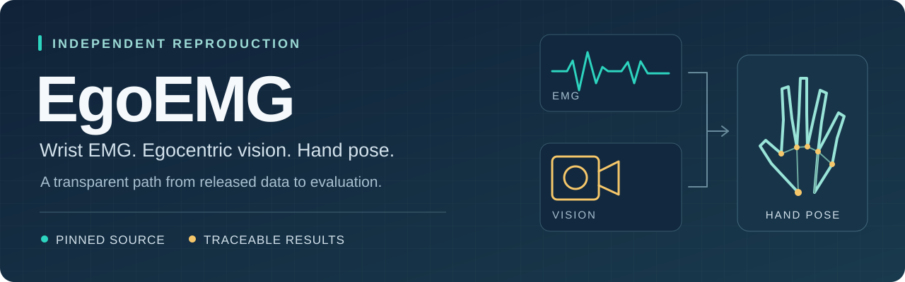
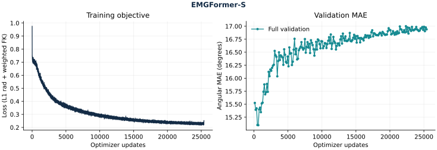
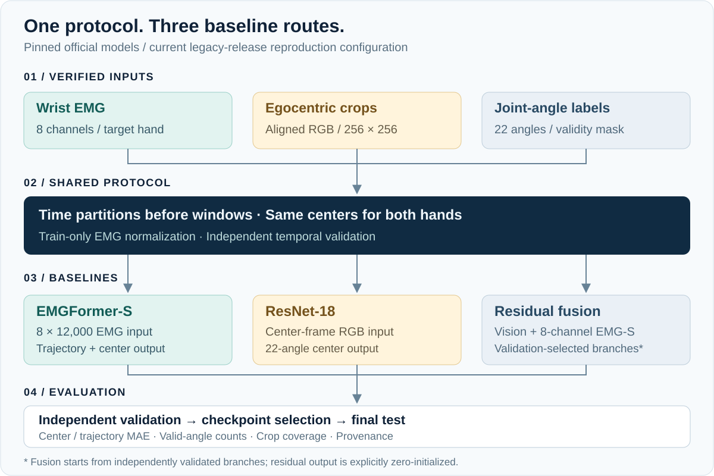

> **2026-11-02 原生ResNet-18完整结果**：[报告／原始JSON／真实训练曲线](results/original-resnet/resnet18/README.md)完成150轮／33,750更新，验证best第136轮；完整测试、独立typed重放和退出后52文件57.145GB来源核验均已结束，原40＋收集4个拥有进程关闭。唯一手样本中心MAE **6.607195°**，有图子集 **6.469979°**；论文RN18 Avg5.9°，数值差约+0.71°。新[14模型数值参照](results/paper-comparison/README.md)保留历史legacy及其匹配融合收益，不把不同协议混作受控排名，整篇仍未完成。
>
> RN18兼容cotrain-S已通过原batch260／12workers的真实GPU资格2轮／4更新与六域恢复，正式150轮正在运行；融合正式训练仍欠。RN50/152已从最新78/32轮断点实际恢复六类状态，并重建后续轨迹/IK资格队列，见[最新接续记录](results/native-resnet-shared-recovery-and-downstream-20261102.json)；仍无新完整最终成绩。marker/腕部独立接续再次停止；原16MiB范围只读诊断确认当前Drive配额页面，原1GiB保留、完整文件仍为0，详见[实际记录](docs/raw-marker-acquisition.md)。ViT-S三类定性图与完整密遮挡分析此前均已验收，详见[全文当前清单](docs/full-paper-status.md)；以下较早条目是各自时点的历史快照。

> **2026-11-01 最新推进 · 北京时间22:48**：[Figure7普通网格输入](results/native-qualitative/README.md)完成4,530选中手样本×2真实读取及退出后独立重建，原始49,830数组指纹一致；三模型普通网格推理和三类最终例图仍欠。[ViT-S完整遮挡分析](results/native-dense-occlusion/vits-full/README.md)此前已验收；论文人口／数值等价限制仍在，全文尚未完成。

> **2026-11-01 最新推进 · 北京时间18:58**：[真实B64遮挡资格](results/native-dense-occlusion/trained-b64-qualification-complete-20261101.json)已通过：两遍各528点/12批精确重放，48个读取子进程＋6个资格阶段拥有者关闭；服务器自动进入完整17,168点×2遍预测，完整统计/相关/Figure13尚未完成。[原生EMGFormer全轨迹输入层](docs/native-emgformer-trajectory.md)新增28项检查全部通过、无跳过，保留中心结果并单独扫描完整窗口标签；这是val4/test8的真实memmap工程验收，尚未运行新全轨迹模型评价。完整原生S/M/L训练与中心报告已另完成，架构家族仍14，全文目标继续。

> **2026-11-01 最新验收 · 北京时间18:38**：[原生EMGFormer-L](results/original-emgformer/large/README.md)完成200轮/25,000正式更新，验证best第142轮；完整val/test及独立重放通过，36当前＋6资格拥有进程关闭，2,792唯一样本中心pooled MAE **16.573467°**。S/M/L原生200轮与中心评价现均完成，新原生全轨迹评价仍欠，未替换Table2行，架构家族仍14。[遮挡完整预测入口](results/native-dense-occlusion/README.md#完整预测重放与报告入口)一次集成审查的两项实质问题已修正，新增25项检查通过；真实CPU batch64/4workers资格及后续完整双遍预测/报告队列已脱离本机启动，资格尚未完成，Figure13及全文仍未完成。RN18/50与EMG2Pose等原流程继续，RN152按原队列等待L闭环后自行启动。

> **2026-11-01 最新验收 · 18:07北京时间**：[原生EMGFormer-M](results/original-emgformer/middle/README.md)完成200轮/25,000正式更新，验证best第124轮；完整val/test及独立重放通过，36当前＋6资格拥有者关闭，中心pooled MAE **16.441148°**。这是中心评价，未替换Table2轨迹行。遮挡分析的[两遍完整配对输入](results/native-dense-occlusion/paired-full-io-complete-20261101.json)也已结束：54文件/61,379,659,366字节四次完整SHA核对，28,282请求每遍全部保留，6拥有者关闭；[真实训练三模型载入10项检查](results/native-dense-occlusion/trained-model-tests-20261101.json)通过，实际完整预测/Figure13仍未完成。ResNet-18资格链已结束并于17:59进入正式训练，ResNet-50正式训练也在跑，L与EMG2Pose等原流程继续；科学架构家族仍14。



> **2026-11-01 RN18初始化修正版已部署 · 15:58北京时间**：[RN18兼容cotrain-S](docs/rn18-cotrain-initializer.md)一次审查修正后的98项工程检查、两次完整数据重验及独立CPU恢复/原生BEST导出已通过；[原batch260/12workers后续队列](results/rn18-cotrain-fixed-source-server-queue-20261101.json)已在服务器独立运行，等待原生RN18视觉完整流程退出后才执行GPU资格和新鲜150轮，当前尚未开始正式训练。[EMG2Pose-S启动入口修复](results/emg2pose-small-spawn-entry-repair-20261101.json)保留原19轮检查点，新后台流程重新核验完整来源后接续，最终评价队列同步等待新流程。已完成科学设置仍14，全文复现尚未完成。

> **2026-11-01 RN18融合原生模型接入工程验收**：[本路线98项检查](results/native-rn18-fusion-runtime-tests-20261101.json)及[独立CPU四阶段](results/native-rn18-fusion-runtime-cpu-20261101.json)通过，10原拥有者关闭；124个视觉张量与106个允许迁移的EMG张量精确加载，4个EMG预测头按官方规则跳过。实际一次Adam更新、未冻结BatchNorm状态及更新前后新进程完整预测重开均已核验。当前使用明确标记的工程分支，完整训练权重交接、GPU资格与融合150轮仍未完成，不新增论文成绩。

> **2026-11-01 密网格完整GT输入已核验，真实原生计算已开始**：[数据/原生流程证据](results/native-dense-occlusion/README.md)覆盖ViT-S17,168手请求、RN18=11,114，实际β/姿态/变换/标志两次完整提取一致，6拥有者关闭；分别保留518/327个零姿态。30项数据检查＋20项入口检查通过。两路线真实双手MANO/遮挡小样本及独立原始包验证已结束，8阶段拥有者关闭，随后完整第一遍实际开始；各自后续独立核验及第二遍完整原生重放尚未结束。代码仍用官方1920×1080回退、原X镜像约定与固定原生几何数学，不声称实际视频/物理投影等价。模型预测、增益/SEM/Spearman和Figure13仍未完成，科学模型设置仍14。

> **2026-11-01 密网格真实索引与来源覆盖验收**：[完整证据与剩余项](results/native-dense-occlusion/README.md)已发布：ViT-S实际17,168唯一手请求，与PDF Figure13数量一致；RN18实际11,114。每路线两次原生重建完全一致、10拥有者关闭。另两进程从实际已完成的融合/视觉/EMG初始化来源重建分区，24次完整布尔行掩码独立核对、6拥有者关闭；ViT-S有1,280手窗口与融合训练输入范围相交，中心帧交集为0，原样本完整保留并披露。当前只完成密索引/输入覆盖分析；密GT几何、实际预测误差、bin/SEM/样条/Spearman及Figure13尚未完成，完整科学设置仍14。

> **标准几何样本汇总已验收 · 2026-11-01 北京时间13:58**：[CSV/JSON与统计说明](results/native-point-geometry/README.md)、[实际独立重算证明](results/native-geometry-population-report-20261101.json)已就绪：val/test全部5,882唯一手请求，5,683有效几何＋199零姿态。测试集4,178个有效几何中，42个全部顶点在相机后方/近相机，20个前方顶点全部越界，4,116个存在可见顶点；官方原始分数完整保留。两次独立进程重开全部原始字节并重算汇总一致，6个本次拥有进程及原20个拥有进程均关闭；无新模型训练。官方1920×1080回退、未用畸变及左右约定差异仍明确，密1/4stride/模型误差/增益/相关及Figure13仍欠，完整科学设置仍14。

# EgoEMG Reproduction

> **2026-11-01 两条路线完整密GT均已验收**：[ViT-S真实完成证据](results/native-dense-occlusion/vits-geometry-complete-20261101.json)新增17,168手请求双遍原生计算、三次原始核验和216,450数组精确重放；14原拥有者＋2比较拥有者全部退出。连同既有RN18，共28,282请求/845保留零姿态，32拥有者已关闭；原生数学与1920×1080官方回退保持。16项统计与26项连接检查已通过，真实冻结模型预测、paired gain/Spearman与Figure13仍未完成。

> **2026-11-01 原生EMGFormer-S完整实验验收**：[200轮与最终报告](results/original-emgformer/small/README.md)完成25,000次正式更新，验证best为第169轮；完整val/test各由新进程精确重放，20阶段/42拥有者全部退出。2,792唯一测试手样本的中心pooled MAE为16.582811°，原生batch加权为16.577803°。原始三份报告按字节发布，未替换legacy轨迹值或声称Table2轨迹14.7°已对齐；S仍计入既有14个架构家族，M/L及其他全文缺口继续进行。

> **2026-11-01 遮挡统计接口已对齐官方脚本**：[16项实际检查与来源诊断](results/native-dense-occlusion/README.md#官方误差转换与统计接口)通过。独立进程执行未修改官方绘图main，全部bin均值/SEM、200点加权三次样条、Spearman和抽样索引完全一致；工程PNG不计论文实验。真实完整密网格模型预测、Figure13仍未完成，科学模型设置仍14。

> **2026-11-01 RN18视觉来源与完整密GT验收**：[历史RN18 LAST](results/native-rn18-fusion-trained-vision-last-admission-20261101.json)完成两次独立全量输入准入、完整150轮/10,650更新来源核验及124张量导出/重开，6原拥有者关闭；它保留legacy0.01等来源差异，可作为本折融合的视觉分支。[RN18密GT](results/native-dense-occlusion/rn18-geometry-complete-20261101.json)11,114手请求两遍原生计算、三次独立原始核验及140,231数组重放一致，14原拥有者＋2后验拥有者关闭。EMG cotrain150轮、新原生融合训练、ViT密GT和Figure13仍未完成，科学模型设置仍14。

> **当前目标 · 全论文复现进行中（2026-11-01）**
>
> 用户目标已扩展为论文全文；有歧义时优先固定官方代码。范围覆盖 **Tables 1–15、Figures 1–13、全部作者模型、EMG2Pose、标注与预处理、数据统计和派生分析**。原四项 legacy 基线是已完成的历史子集；新增 [ResNet-50](results/completed/resnet50/README.md)和[ResNet-152](results/completed/resnet152/README.md)均完成150轮、完整验证选模、最终测试与独立复算，全部中心 MAE 分别为6.640058°和5.982738°。新增[EMGFormer-L](results/completed/emgformer-l/README.md)也完成200轮、最终测试与独立中心复算，全部中心16.612111°。七项均保留legacy数据及0.01损失协议，不代表论文原表等价。[classic CPU训练与恢复](docs/classic-emg.md)、[短程CUDA数值/状态恢复](results/classic-cuda-numeric-engineering.md)和[原批量600/256容量检查](results/classic-cuda-capacity-engineering.md)已完成；[VEMG原生配方完整实验](results/original-classic/vemg2pose/README.md)已完成62轮早停训练、原生测试和独立完整复算，轨迹／中心MAE为16.452932°／16.347705°（新的4,306测试手样本队列）；[NeuroPose原生完整实验](results/original-classic/neuropose/README.md)也已完成73轮早停、最终测试与独立复算，轨迹／中心MAE为16.358404°／16.411552°；先前失败证据保留。新增[测试复算与完整报告](docs/classic-report.md)已完成审查修正与CPU集成，VEMG实际12阶段报告链已全部通过，最终公开字节与完成标记已核验。[手形统计与聚合图](results/dataset-statistics/shape-statistics.md)已从真实82手数据生成并核验，PDF显示微差与统计列歧义照实保留。全文状态与真正缺口见[全论文证据清单](docs/full-paper-status.md)，动态进展见[运行状态](docs/run-status.md)，验收范围见[全文设计](docs/superpowers/specs/2026-10-26-full-paper-reproduction-design.md)。

> **当前验收状态 · 2026-11-01 09:31北京时间**：已有14项完整实验设置。用户优先指定的[ViT-L](results/original-vision/vit-large/README.md)、[WiLoR](results/original-vision/wilor/README.md)和[ViT-S＋EMGFormer-S融合](results/original-fusion/vit-small-emgformer-small/README.md)均已完成完整训练、验证选模、最终测试、独立完整重放和报告核验；全部中心MAE分别为6.229674°、5.107042°、6.342238°。WiLoR30轮/336,720更新，融合150轮/296,550更新；本次续训及评价控制器均退出0，所属进程已确认关闭；原始报告和曲线字节已核对。[终态验收快照](results/core-priority-status-20261101.json) · [运行记录](docs/run-status.md)。整篇论文及PDF数值等价仍未完成。

> **剩余实验续行 · 2026-11-01 10:04北京时间**：[七项服务器后台流程](results/full-paper-execution-20261101T0204.json)独立运行。原生EMGFormer-S已进入正式200轮；[原生M/L完整输入与GPU恢复](results/native-emgformer-ml-input-and-fit-qualification-20261101.json)通过，正在独立验证/测试资格链，其后自动进行各自200轮及最终评估。EMG2Pose S/M/L仍在完整来源准入。新增右手有效性文件完整1.389GB，几何传输5/8、其余三文件在服务器继续接收。本机关机不终止已部署流程；完成科学设置仍14，暂无新增最终成绩。

> **标准几何两角色已完整结束 · 2026-11-01 13:46北京时间**：[两角色真实验收](results/native-point-geometry-standard-roles-20261101.json)覆盖val/test全部5,882唯一手点：每角色两遍原生计算及两次独立核验，5,683有效几何点、199零姿态请求保留。原20个拥有进程全部关闭，11,366个原生数组包退出后SHA一致。此项完成标准网格计算与重放；可见/越界统计导出、1/4stride密网格、模型误差/增益/Spearman和真实视频仍待补齐，不能声称Figure13或全论文完成。科学模型设置仍14。

> **RN18融合完整输入已核验 · 2026-11-01 13:42北京时间**：[新路线与来源边界](docs/native-rn18-fusion.md)已落实原8通道/12,000点/Adam/10workers配方；完整运行时81项通过，另有40项纯检查在无Torch环境通过、41项真实运行时检查明确跳过。两次真实完整输入准入内容身份一致，覆盖53个实际消费payload/61.377GB、62,470／1,052／2,792唯一手样本，6原拥有进程全部关闭。正式融合还需严格的预训练来源、真实模型/GPU与150轮，未新增MAE。

> **完整几何验证集已结束**：[1,576手点两遍原生计算与独立核验](results/native-point-geometry-complete-val-20261101.json)已结束，10原拥有进程关闭，3,010个原生数组包退出后字节SHA一致；71个零姿态请求保留。测试集两遍4,306点计算也已完成，13:42时仍在最后一次独立核验。视频尺寸仍是明确的1920×1080官方回退，密1/4stride与Figure13未完成；完整科学设置仍14。

> **几何完整网格与ResNet后续队列 · 2026-11-01 13:01北京时间**：[几何单次审查修复](results/native-point-geometry-review-corrections-20261101.json)已完成，83项普通检查及另行实际运行的1项合法资产测试通过；两次真实双手MANO/自遮挡执行与原生数组重放完全一致，12个拥有进程全部关闭。[完整val/test标准网格](results/native-point-geometry-full-launch-20261101.json)现已在服务器独立执行，共5,882个手点、每角色两次原生执行和两次独立核验；当前为在跑，仍未完成全量重放或密网格/Figure13。视频缺失，明确采用官方1920×1080回退，不声称实际分辨率已观测。

> [RN18/50/152后台后续队列](results/native-resnet-full-cli-queue-20261101.json)也已部署并确认存活：分别等待原生EMGFormer-M/S/L占用的GPU0/1/7及其全部拥有者正常退出后，才以原batch900/400/180、8workers做真实GPU恢复/完整验证测试资格，再进入全新150轮上限训练。无等待截止或自动重试；目前尚未开始这些新GPU训练。全部已部署队列可随服务器独立运行，本机关机不影响。完成科学设置仍14。

> **三种ResNet完整输入已核验 · 2026-11-01 12:52北京时间**：[完整准入与独立重开](results/native-resnet-full-cohort-admission-20261101.json)覆盖52个实际payload，每模型两遍完整读取、内容身份一致，train/val/test为202,020/3,152/8,612消费点。三个流程及18个拥有进程均正常退出；尚未运行新GPU资格或正式150轮，完成科学设置仍14。

> **2026-11-01 ResNet单次审查修复（北京时间12:25）**：新组件审查的两项Important问题已修复，[当前源码134项检查](results/native-resnet-review-corrections-20261101.json)全部通过、无跳过：数据34、真实三主干运行时18、训练62、评估20。实际dtype/shape/strides/offset变更、三处helper源码变化及读取过程中的源码代际变更均先触发失败再修复；检查点读取、训练和缓存报告链均覆盖完整来源保护。三个独立CPU进程重开数据、生成并复核报告，均0模型/0更新/无CUDA。真实GPU资格、完整数据准入及正式训练仍待各自实证；没有重跑已封闭的核心模型，完成科学设置仍14。

> **2026-11-01 几何完整数值准入（北京时间12:25）**：[8文件/37,778,344,975bytes全量数值校验](results/legacy-geometry-complete-numeric-admission-20261101.json)完成：66,161,725行、41段连续元数据、三种变换的旋转误差均小于4.64e-6，全部浮点有限；两手实际β与校准已绑定。标准测试网格4,306唯一手样本中4,178行有有限非零MANO姿态，128行零姿态保留，未改标签或训练输入。原下载与扫描进程均正常退出；逐帧mesh/自遮挡、1/4stride密测、实际视频尺寸与Spearman仍待执行，不能据此声称Figure13或论文相关系数已复现。

> **ResNet训练/评估历史快照 · 2026-11-01**：[原生CPU完整工程链](results/native-resnet-fit-eval-engineering-20261101.json)75项通过：真实RN18第2→4轮CLI续训、六状态一致、原生每两轮验证、完整验证/测试独立重放和报告新进程复核均完成。当前为工程样本；本条为审查前工程快照，真实GPU资格与正式训练仍待后续验收，科学完成设置仍14。

> **ResNet接入进展 · 2026-11-01**：[数据与真实模型恢复证据](results/native-resnet-runtime-and-data-20261101.json)已记录合并76项通过及门控更新后18项运行时通过，三种ResNet的原始ImageNet初始化、0.02损失梯度、完整状态/预测独立恢复已核验。数据检查采用工程样本；原生验证间隔、正式训练和最终测试仍待完成，科学完成设置保持14。

> **后续工作补齐 · 2026-11-01**：[EMG2Pose-S训练后评估与几何进度](results/small-final-queue-and-geometry-assets-20261101.json)已记录：S最终评估队列在服务器独立等待250轮；几何传输6/8，标定与两手beta已就绪。[原生ResNet配置接口](results/native-resnet-protocol-20261101.json)28项检查通过，RN18/50/152的0.02官方/明确派生路线进入实现；原生ResNet训练和RN18+S官方配方尚未完成，科学完成设置仍14。

> **结果与论文的差距：** [14项已完成MAE逐项对照](results/paper-comparison/README.md)保留Table2/3原表、当前结果和原始来源SHA；WiLoR为5.107042°对论文4.7°，ViT-S融合为6.342238°对论文5.5°。当前总体数值均高于PDF；数据和协议未完全对齐，不能声称同条件核心数值或全部模型优势已复现。

> **新增协议审计：** 固定官方EgoEMG配置经Hydra合成与别名归约后，指尖项有效系数为0.02；既有legacy配方使用0.01。此前这一差异漏核，[实际11配置审计](results/official-loss-audit.md)已公开说明，旧结果与在跑legacy实验不能称为该官方损失的等价复现。EMG2Pose三项无此叠加，仍为0.01。

新增[60类手势词表](results/dataset-semantics/gesture-vocabulary.md)、[22角语义](results/dataset-semantics/joint-angle-semantics.md)及[真实帧覆盖](results/dataset-semantics/coverage.md)已经独立核验；66,161,725个共享同步帧包含全部60类。帧数不等于窗口/手样本数，尚不构成逐手势模型误差结果。

[冻结中心点读](results/dataset-semantics/center-coverage.md)另核验33,508窗口/67,016手中心，含2,792测试手中心和逐角有效性；train/val/test实际覆盖51/32/59类。该统计保持旧12000/stride1200协议，不等于新classic队列或模型误差分析。

[EMG2Pose真实mini工程验收](results/emg2pose-mini-optimization.md)也已完成：S/M/L各2次实际更新、两遍全部526窗口及严格完整状态重载一致。mini全为原val，这项检查不能作为独立验证或论文精度；完整数据与三个完整训练仍待完成。

新增[原始普通文件共享实验控制器](results/emg2pose-direct-experiment-engineering.json)：本机/服务器各43项检查，一个S模型的14阶段GPU工程流程及控制器退出后的独立重读通过；共享编排与逐模型训练/评价资格分别核验，真实资源观测不注入。完整源及三项250轮仍待完成。

新增[普通原文件最终报告核验](results/emg2pose-direct-final-report-engineering.json)：本机/服务器各58项检查、三模型两模式GPU结果的6个只读CPU报告阶段全部通过；保留原验证选best/完整复算与Table11/13算术，工程报告始终不代表完整源或250轮成绩。全量科学控制器仍待接通。

新增[原始普通文件FP32完整批量证据](results/emg2pose-direct-evaluation-capacity-engineering.json)：S/M/L在两种选择下均完成每pass321窗、实际320+1/12worker/FP32的原生评价和新进程精确复推。显式合成5,009,750行经无损HDF压缩，原转换字段全等；37成功阶段及1次保留的私有读取失败如实列示，只重做最后CPU读取，没有GPU重训/重测。完整数据、三个250轮与科学报告仍欠。

新增[完整原包的内存存储接入](docs/emg2pose-memory.md)：服务器647MB完整mini接收与30HDF5/4,218,756行盘点已通过；新存储适配与原官方读取器的全部526窗口、样本元数据和RNG一致。[新原生工程证据](results/emg2pose-memory-native-engineering.json)中S/M/L各完成2次CPU更新、全部526窗口新进程精确复推，以及原生完整状态加载后再更新一次到step3；拥有的内存fd全部关闭。一次实现审查发现的最终HEAD阻塞期间内存压力检查问题已通过真实RED→GREEN修正；最终107成员完整检查1,719通过/3实际CUDA skip、轻量939/691依赖skip均实际exit0。完整462.8GB源、资源/进程控制器及三项完整实验仍欠，不能填论文Tables11/13。本机持久化下载进度保留。

新增[受管理的源数据准备入口](results/emg2pose-memory-preparation-engineering.json)已实际核验完整mini，仅发布独立验证过的紧凑索引；本机/服务器各66项定向检查和111成员整体1,767/3实际CUDA skip、轻量987/691依赖skip通过。[三模型原批量GPU容量检查](results/emg2pose-memory-native-gpu-capacity.json)也已完成：S/M/L各两次batch320、12worker、bf16更新，以及两轮完整526窗口原生验证；仍是mini原val工程夹具，没有独立科学训练、GPU状态恢复或250轮完整结果。

[](https://github.com/ZSHYC/EgoEMG-Reproduction/actions/workflows/tests.yml)
[](https://arxiv.org/abs/2605.05712v1)
[](LICENSE)

**从腕部肌电与第一视角图像，复现可核验的手部姿态估计基线。**

这是论文 *EgoEMG: A Multimodal Egocentric Dataset with Bilateral EMG and Vision for Hand Pose Estimation* 的独立复现仓库，基于[固定版本的官方实现](https://github.com/zhenqis123/EgoEMG/tree/f7cbd048b7092139852270491d3859cd472e0311)，覆盖 EMG、视觉和残差融合三条路线。本项目与[官方仓库](https://github.com/zhenqis123/EgoEMG)分别维护。

> **既有四基线进度快照 · 2026-10-25**
>
> 全部 41 份 legacy 裁剪及 EMG、标签、中心覆盖已校验。**获批的 legacy 四基线完整训练与审计已完成：** EMGFormer-S/M（各 200 轮）、ResNet-18 与 RN18+S 融合（各 150 轮）均通过独立验证选模、最终测试、严格导出及锁定检查点复算。见[完整结果、环境与曲线](results/completed/README.md)。论文 v1 精确数值等价仍未证明，其他论文扩展尚未运行；证据与边界见[运行状态](docs/run-status.md)。

[全论文状态](docs/full-paper-status.md) · [论文解读](docs/paper-guide.md) · [复现对照表](docs/reproduction-matrix.md) · [训练指南](docs/training.md) · [实验结果](docs/results.md) · [运行证据](docs/run-status.md)

> [DINOv2原生训练与评价](docs/vision-literal.md)：[ViT-S](results/original-vision/vit-small/README.md)、[ViT-B](results/original-vision/vit-base/README.md)、[ViT-L](results/original-vision/vit-large/README.md)均已完成完整训练、验证选best、最终测试、新进程完整重放及报告核验；全部中心MAE分别为6.464179°、6.761261°、6.229674°。测试均为4,306唯一手样本/原repeat2消费8,612。L使用显式原生激活重计算，从磁盘中断后的真实108轮状态续训至132轮早停，六域恢复和完整评估链均通过，原失败证据保留。保留原0.02损失及旧队列/单rank适配；B/L明确从S配方派生，没有PDF或多seed等价结论。全文范围见[全论文状态](docs/full-paper-status.md)。

## 复现什么

论文研究双侧腕部 EMG 与第一视角视觉在手部姿态估计中的互补性。本仓库围绕公开 legacy 数据，建立从获取数据到独立验证选模、最终测试与结果追溯的完整流程。

下表保留既有完整 legacy 实验的真实成绩；全文目标中的其他模型、标注、数据与表图另按[完整清单](docs/full-paper-status.md)逐项验收，不能以本表作为全文完成证明。

| 路线 | 本次配置 | 完整实验状态 | 全部中心测试 MAE ↓ |
| --- | --- | --- | --- |
| **EMG → Pose** | EMGFormer-S · 8 通道 · 12,000 点 · 200 epochs | 训练器测试、严格导出及独立复算通过 | **16.3138°** |
| **EMG → Pose · 比较** | EMGFormer-M · 8 通道 · 12,000 点 · 200 epochs | 训练器测试、严格导出及独立复算通过 | **16.4908°** |
| **Vision → Pose** | ResNet-18 · 中心帧手部裁剪 · 150 epochs | 训练器测试、严格导出及独立复算通过 | **7.7849°** |
| **EMG + Vision → Pose** | ResNet-18 + EMGFormer-S · 8 通道残差融合 · 150 epochs | 训练器测试、严格导出及独立复算通过 | **6.7935°** |
| **EMG → Pose · L** | [EMGFormer-L](results/completed/emgformer-l/README.md) · 200 epochs | 训练器测试、严格导出及独立中心复算通过 | **16.6121°** |
| **Vision → Pose · RN50** | [ResNet-50](results/completed/resnet50/README.md) · 150 epochs | 训练器测试、严格导出及独立复算通过 | **6.6401°** |
| **Vision → Pose · RN152** | [ResNet-152](results/completed/resnet152/README.md) · 150 epochs | 训练器测试、严格导出及独立复算通过 | **5.9827°** |

七项结果均来自实际完整运行，分别使用冻结配方与独立输出目录。全部模型使用同一冻结测试中心和有图匹配子集；不以短训练或论文参考值替代本项目成绩。指标定义与来源见[实验结果](docs/results.md)。

上述 MAE 来自本项目的 legacy 数据重训练，覆盖 2,792 个单手测试中心、59,572 个有效角度。匹配有图子集、EMG 完整轨迹、分组指标及训练曲线见[完整报告与审计](results/completed/README.md)；RN18 与融合输出中心预测，没有轨迹成绩。这些结果与论文原表的队列和设置不等价。

<details>
<summary>查看 EMGFormer-S 完整训练与独立验证曲线</summary>



该图来自完整运行的 25,400 次更新与 200 次独立验证；左图为训练目标函数，右图为验证 MAE（度）。模型按验证集选定，最终测试见上表。[M 完整曲线与审计](results/completed/README.md)、[早期历史快照](results/live/emg-s/status.md)另行保留。

</details>

## 从数据到结果



- **固定来源。** 官方模型类保持原样，训练入口校验源码、配置、数据与检查点身份。
- **独立选模。** 从官方训练区间留出连续时间验证块，先划分后构造窗口；双手共享划分，EMG 归一化只使用最终训练窗口覆盖的唯一行。
- **保留分母。** 按有效角度计数汇总 MAE，区分中心帧与完整轨迹；视觉另外报告 crop 有效子集及缺失数量。

当前划分有 **63,172 / 1,052 / 2,792** 个训练 / 验证 / 测试单手窗口样本。它们按“窗口 × 手”计数，验证是训练用户内的时间留出。协议与适配调整见[复现对照表](docs/reproduction-matrix.md)。

实际测试窗口覆盖 **40 人**：41 个 episode 中有 1 个短于完整输入窗口。另据保存的窗口核验，发布的 User、Both 标签分组各有 **1 名用户**也出现在训练窗口中，因此这两组不能解释为严格无用户交集的测试。数量、来源身份和计数范围见[队列覆盖记录](results/cohort-coverage.json)。

## 快速开始

在有 **Conda 和 CUDA** 的运行主机上执行。EMG/标签约 18.39 GB，全部视觉裁剪另需约 45.04 GB；下载器额外保留至少 15 GiB 磁盘余量。固定环境与完整命令见[训练指南](docs/training.md)。

**1. 获取源码，建立独立环境**

```bash
git clone https://github.com/ZSHYC/EgoEMG-Reproduction.git
cd EgoEMG-Reproduction
bash scripts/bootstrap_upstream.sh upstream
bash scripts/setup_environment.sh "$PWD/.venv"
PY="$PWD/.venv/bin/python"
"$PY" -m pip install -e '.[test,vision]' --no-deps
```

**2. 获取并校验 EMG、标签与对齐字段**

```bash
"$PY" -m egoemg_repro.download --root data/legacy --metadata-only
"$PY" -m egoemg_repro.download --root data/legacy --workers 4
"$PY" -m egoemg_repro.crops download \
  --root data/crops --data data/legacy --fields-only --workers 2
"$PY" -m egoemg_repro.partitions \
  --data data/legacy --output outputs/partitions.json
```

按顺序执行，让各分支训练前的数据 receipt 保持一致。完整视觉裁剪可在独立的 `data/crops` 目录继续下载，参阅[下载说明](docs/download.md)和[视觉数据指南](docs/vision.md)。

**3. 先运行两步真实数据检查**

```bash
"$PY" -m egoemg_repro.train \
  --data data/legacy --upstream upstream \
  --config configs/emgformer_s.json --output runs/emg_s_check \
  --device cuda:0 --batch-size 2 --num-workers 0 --max-steps 2
```

`--max-steps` 限制训练与验证，并跳过最终测试；其产物仅用于集成检查。完整训练使用新的输出目录，默认 batch 为 EMG **500**、视觉 **900**、融合 **200**。恢复、完整评估和融合分支初始化的要求见[训练指南](docs/training.md)。

## 如何理解当前证据

已经完成的工程验收包括完整运行时测试，以及真实 EMG 两步优化、严格重载、两次一致验证与迁移目录恢复。视觉和融合也已使用真实裁剪的**重复双手样本**通过有限值与显存检查；这些检查不支持完整 cohort 的精度或收敛结论。[脱敏集成证据](results/integration-evidence.json)保留当时的工程验收范围与未完成标记，不代表当前终态。此后全部 41 份裁剪与中心覆盖通过 G1，见[裁剪就绪证据](results/crop-readiness.json)；四模型均已完成完整训练和审计。RN18 完成 150 轮、10,650 次更新，验证选择第 6,319 次更新；融合完成 150 轮、47,400 次更新，验证选择第 36,024 次更新。四份报告的中心集合、身份及有效分母已匹配核验。

解释任何后续数字时，仍需保留以下边界：

| 边界 | 对结论的影响 |
| --- | --- |
| **legacy 数据与标签** | 41 人版本与论文人数一致，但公开生成标签尚未证明与论文标签流程等价。 |
| **发布分组与用户交集** | 实际测试覆盖 40 人；旧版 User、Both 各与训练窗口有 1 名用户交集，按发布中心标签报告，不能称为严格未见用户测试。 |
| **输入与融合配置** | 当前使用发布兼容的 12,000 点窗口，论文的 7,790 点设置另行区分；清洁融合采用 8 通道分支与显式零残差初始化，区别于发布的 16 通道融合检查点。 |
| **上游整 episode FFT** | 窗口行足迹分离不能消除预过滤引入的跨时间依赖，不能据此宣称原始预处理严格隔离。 |
| **视觉覆盖与指标人群** | 完整文件与目标中心覆盖已核验；训练/验证/测试缺图为 3,739/63,172、67/1,052、104/2,792。缺图样本保留并计数，同时报告全部有标签中心与 crop 有效子集；这不证明发布的视频帧对齐质量已校正。 |

本仓库已完成获批四基线的可追溯 **legacy release 独立验证重训练与审计**。这不覆盖论文全部模型、其他数据集或标签生成训练；与论文 v1 设置的逐项差异见[复现对照表](docs/reproduction-matrix.md)，实际完成记录见[运行状态](docs/run-status.md)。

## 文档导航

| 想了解什么 | 入口 |
| --- | --- |
| 论文的数据、模型、损失与实验设计 | [论文解读](docs/paper-guide.md) |
| 论文、固定官方源码与本次实现有何差异 | [复现对照表](docs/reproduction-matrix.md) |
| 安装、训练、恢复、独立评估 | [训练指南](docs/training.md) |
| 断点下载、文件校验与磁盘预留 | [下载说明](docs/download.md) |
| 视觉帧对齐、LMDB、缺失裁剪与融合初始化 | [视觉数据指南](docs/vision.md) |
| 已完成的运行证据、结果与尚待完成项 | [运行状态](docs/run-status.md) · [实验结果](docs/results.md) |

## 引用与许可

使用本项目开展研究时，请引用[原论文](https://arxiv.org/abs/2605.05712v1)，并记录本仓库地址与所用提交。论文作者为 Ziheng Xi、Jiayi Yu、Yitao Wang、Yanbo Duan、Jianjiang Feng、Jie Zhou；引用元数据见 [CITATION.cff](CITATION.cff)。

本仓库原创内容适用 [MIT License](LICENSE)。外部资产保留原有条款：上游基线声明 MIT，继承的 emg2pose 部分使用 CC-BY-NC-SA-4.0，详见[固定上游许可证](https://github.com/zhenqis123/EgoEMG/blob/f7cbd048b7092139852270491d3859cd472e0311/LICENSE)。

本仓库不分发论文 PDF、参与者元数据、信号、视频、模型权重或 MANO 资产。首页插图为本项目原创示意图。
