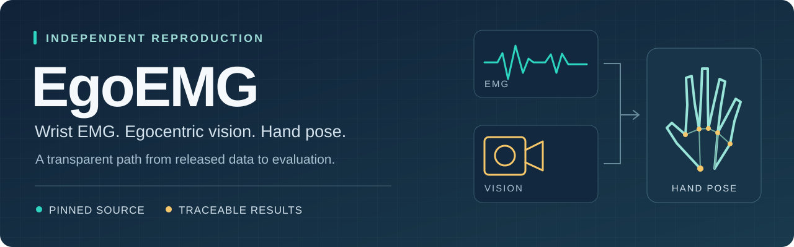
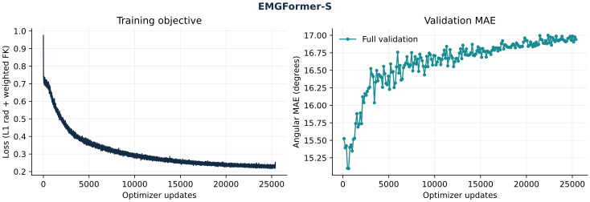
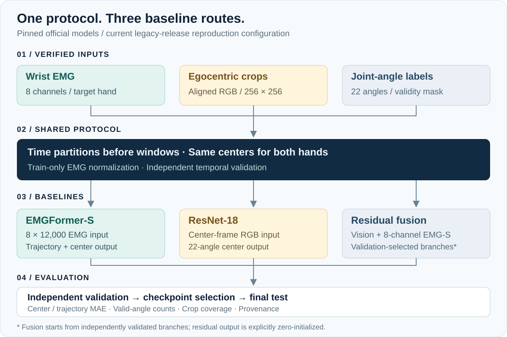

# EgoEMG Reproduction

> **当前目标 · 全论文复现进行中（2026-10-26）**
>
> 用户目标已扩展为论文全文；有歧义时优先固定官方代码。范围覆盖 **Tables 1–15、Figures 1–13、全部作者模型、EMG2Pose、标注与预处理、数据统计和派生分析**。四项 legacy 基线是已完成的历史子集。EMGFormer-L（200轮）、ResNet-50/152（各150轮）均已通过真实GPU短训练、完整验证与严格重载，正式训练正在进行，尚无新增完整结果。[手形统计与聚合图](results/dataset-statistics/shape-statistics.md)已从真实82手数据生成并核验，PDF显示微差与统计列歧义照实保留。全文状态与真正缺口见[全论文证据清单](docs/full-paper-status.md)，动态进展见[运行状态](docs/run-status.md)，验收范围见[全文设计](docs/superpowers/specs/2026-10-26-full-paper-reproduction-design.md)。

> **新增协议审计：** 固定官方EgoEMG配置经Hydra合成与别名归约后，指尖项有效系数为0.02；既有legacy配方使用0.01。此前这一差异漏核，[实际11配置审计](results/official-loss-audit.md)已公开说明，旧结果与在跑legacy实验不能称为该官方损失的等价复现。EMG2Pose三项无此叠加，仍为0.01。

新增[60类手势词表](results/dataset-semantics/gesture-vocabulary.md)、[22角语义](results/dataset-semantics/joint-angle-semantics.md)及[真实帧覆盖](results/dataset-semantics/coverage.md)已经独立核验；66,161,725个共享同步帧包含全部60类。帧数不等于窗口/手样本数，尚不构成逐手势模型误差结果。

[冻结中心点读](results/dataset-semantics/center-coverage.md)另核验33,508窗口/67,016手中心，含2,792测试手中心和逐角有效性；train/val/test实际覆盖51/32/59类。该统计保持旧12000/stride1200协议，不等于新classic队列或模型误差分析。

[EMG2Pose真实mini工程验收](results/emg2pose-mini-optimization.md)也已完成：S/M/L各2次实际更新、两遍全部526窗口及严格完整状态重载一致。mini全为原val，这项检查不能作为独立验证或论文精度；完整数据与三个完整训练仍待完成。

[](https://github.com/ZSHYC/EgoEMG-Reproduction/actions/workflows/tests.yml)
[](https://arxiv.org/abs/2605.05712v1)
[](LICENSE)

**从腕部肌电与第一视角图像，复现可核验的手部姿态估计基线。**

这是论文 *EgoEMG: A Multimodal Egocentric Dataset with Bilateral EMG and Vision for Hand Pose Estimation* 的独立复现仓库，基于[固定版本的官方实现](https://github.com/zhenqis123/EgoEMG/tree/f7cbd048b7092139852270491d3859cd472e0311)，覆盖 EMG、视觉和残差融合三条路线。本项目与[官方仓库](https://github.com/zhenqis123/EgoEMG)分别维护。

> **既有四基线进度快照 · 2026-10-25**
>
> 全部 41 份 legacy 裁剪及 EMG、标签、中心覆盖已校验。**获批的 legacy 四基线完整训练与审计已完成：** EMGFormer-S/M（各 200 轮）、ResNet-18 与 RN18+S 融合（各 150 轮）均通过独立验证选模、最终测试、严格导出及锁定检查点复算。见[完整结果、环境与曲线](results/completed/README.md)。论文 v1 精确数值等价仍未证明，其他论文扩展尚未运行；证据与边界见[运行状态](docs/run-status.md)。

[全论文状态](docs/full-paper-status.md) · [论文解读](docs/paper-guide.md) · [复现对照表](docs/reproduction-matrix.md) · [训练指南](docs/training.md) · [实验结果](docs/results.md) · [运行证据](docs/run-status.md)

## 复现什么

论文研究双侧腕部 EMG 与第一视角视觉在手部姿态估计中的互补性。本仓库围绕公开 legacy 数据，建立从获取数据到独立验证选模、最终测试与结果追溯的完整流程。

下表保留既有完整 legacy 实验的真实成绩；全文目标中的其他模型、标注、数据与表图另按[完整清单](docs/full-paper-status.md)逐项验收，不能以本表作为全文完成证明。

| 路线 | 本次配置 | 完整实验状态 | 全部中心测试 MAE ↓ |
| --- | --- | --- | --- |
| **EMG → Pose** | EMGFormer-S · 8 通道 · 12,000 点 · 200 epochs | 训练器测试、严格导出及独立复算通过 | **16.3138°** |
| **EMG → Pose · 比较** | EMGFormer-M · 8 通道 · 12,000 点 · 200 epochs | 训练器测试、严格导出及独立复算通过 | **16.4908°** |
| **Vision → Pose** | ResNet-18 · 中心帧手部裁剪 · 150 epochs | 训练器测试、严格导出及独立复算通过 | **7.7849°** |
| **EMG + Vision → Pose** | ResNet-18 + EMGFormer-S · 8 通道残差融合 · 150 epochs | 训练器测试、严格导出及独立复算通过 | **6.7935°** |

四项结果均来自实际完整运行，EMGFormer-M 使用独立配方与输出目录。全部模型使用同一冻结测试中心和有图匹配子集；不以短训练或论文参考值替代本项目成绩。指标定义与来源见[实验结果](docs/results.md)。

上述 MAE 来自本项目的 legacy 数据重训练，覆盖 2,792 个单手测试中心、59,572 个有效角度。匹配有图子集、EMG 完整轨迹、分组指标及训练曲线见[完整报告与审计](results/completed/README.md)；RN18 与融合输出中心预测，没有轨迹成绩。这些结果与论文原表的队列和设置不等价。

<details>
<summary>查看 EMGFormer-S 完整训练与独立验证曲线</summary>



该图来自完整运行的 25,400 次更新与 200 次独立验证；左图为训练目标函数，右图为验证 MAE（度）。模型按验证集选定，最终测试见上表。[M 完整曲线与审计](results/completed/README.md)、[早期历史快照](results/live/emg-s/status.md)另行保留。

</details>

## 从数据到结果



- **固定来源。** 官方模型类保持原样，训练入口校验源码、配置、数据与检查点身份。
- **独立选模。** 从官方训练区间留出连续时间验证块，先划分后构造窗口；双手共享划分，EMG 归一化只使用最终训练窗口覆盖的唯一行。
- **保留分母。** 按有效角度计数汇总 MAE，区分中心帧与完整轨迹；视觉另外报告 crop 有效子集及缺失数量。

当前划分有 **63,172 / 1,052 / 2,792** 个训练 / 验证 / 测试单手窗口样本。它们按“窗口 × 手”计数，验证是训练用户内的时间留出。协议与适配调整见[复现对照表](docs/reproduction-matrix.md)。

实际测试窗口覆盖 **40 人**：41 个 episode 中有 1 个短于完整输入窗口。另据保存的窗口核验，发布的 User、Both 标签分组各有 **1 名用户**也出现在训练窗口中，因此这两组不能解释为严格无用户交集的测试。数量、来源身份和计数范围见[队列覆盖记录](results/cohort-coverage.json)。

## 快速开始

在有 **Conda 和 CUDA** 的运行主机上执行。EMG/标签约 18.39 GB，全部视觉裁剪另需约 45.04 GB；下载器额外保留至少 15 GiB 磁盘余量。固定环境与完整命令见[训练指南](docs/training.md)。

**1. 获取源码，建立独立环境**

```bash
git clone https://github.com/ZSHYC/EgoEMG-Reproduction.git
cd EgoEMG-Reproduction
bash scripts/bootstrap_upstream.sh upstream
bash scripts/setup_environment.sh "$PWD/.venv"
PY="$PWD/.venv/bin/python"
"$PY" -m pip install -e '.[test,vision]' --no-deps
```

**2. 获取并校验 EMG、标签与对齐字段**

```bash
"$PY" -m egoemg_repro.download --root data/legacy --metadata-only
"$PY" -m egoemg_repro.download --root data/legacy --workers 4
"$PY" -m egoemg_repro.crops download \
  --root data/crops --data data/legacy --fields-only --workers 2
"$PY" -m egoemg_repro.partitions \
  --data data/legacy --output outputs/partitions.json
```

按顺序执行，让各分支训练前的数据 receipt 保持一致。完整视觉裁剪可在独立的 `data/crops` 目录继续下载，参阅[下载说明](docs/download.md)和[视觉数据指南](docs/vision.md)。

**3. 先运行两步真实数据检查**

```bash
"$PY" -m egoemg_repro.train \
  --data data/legacy --upstream upstream \
  --config configs/emgformer_s.json --output runs/emg_s_check \
  --device cuda:0 --batch-size 2 --num-workers 0 --max-steps 2
```

`--max-steps` 限制训练与验证，并跳过最终测试；其产物仅用于集成检查。完整训练使用新的输出目录，默认 batch 为 EMG **500**、视觉 **900**、融合 **200**。恢复、完整评估和融合分支初始化的要求见[训练指南](docs/training.md)。

## 如何理解当前证据

已经完成的工程验收包括完整运行时测试，以及真实 EMG 两步优化、严格重载、两次一致验证与迁移目录恢复。视觉和融合也已使用真实裁剪的**重复双手样本**通过有限值与显存检查；这些检查不支持完整 cohort 的精度或收敛结论。[脱敏集成证据](results/integration-evidence.json)保留当时的工程验收范围与未完成标记，不代表当前终态。此后全部 41 份裁剪与中心覆盖通过 G1，见[裁剪就绪证据](results/crop-readiness.json)；四模型均已完成完整训练和审计。RN18 完成 150 轮、10,650 次更新，验证选择第 6,319 次更新；融合完成 150 轮、47,400 次更新，验证选择第 36,024 次更新。四份报告的中心集合、身份及有效分母已匹配核验。

解释任何后续数字时，仍需保留以下边界：

| 边界 | 对结论的影响 |
| --- | --- |
| **legacy 数据与标签** | 41 人版本与论文人数一致，但公开生成标签尚未证明与论文标签流程等价。 |
| **发布分组与用户交集** | 实际测试覆盖 40 人；旧版 User、Both 各与训练窗口有 1 名用户交集，按发布中心标签报告，不能称为严格未见用户测试。 |
| **输入与融合配置** | 当前使用发布兼容的 12,000 点窗口，论文的 7,790 点设置另行区分；清洁融合采用 8 通道分支与显式零残差初始化，区别于发布的 16 通道融合检查点。 |
| **上游整 episode FFT** | 窗口行足迹分离不能消除预过滤引入的跨时间依赖，不能据此宣称原始预处理严格隔离。 |
| **视觉覆盖与指标人群** | 完整文件与目标中心覆盖已核验；训练/验证/测试缺图为 3,739/63,172、67/1,052、104/2,792。缺图样本保留并计数，同时报告全部有标签中心与 crop 有效子集；这不证明发布的视频帧对齐质量已校正。 |

本仓库已完成获批四基线的可追溯 **legacy release 独立验证重训练与审计**。这不覆盖论文全部模型、其他数据集或标签生成训练；与论文 v1 设置的逐项差异见[复现对照表](docs/reproduction-matrix.md)，实际完成记录见[运行状态](docs/run-status.md)。

## 文档导航

| 想了解什么 | 入口 |
| --- | --- |
| 论文的数据、模型、损失与实验设计 | [论文解读](docs/paper-guide.md) |
| 论文、固定官方源码与本次实现有何差异 | [复现对照表](docs/reproduction-matrix.md) |
| 安装、训练、恢复、独立评估 | [训练指南](docs/training.md) |
| 断点下载、文件校验与磁盘预留 | [下载说明](docs/download.md) |
| 视觉帧对齐、LMDB、缺失裁剪与融合初始化 | [视觉数据指南](docs/vision.md) |
| 已完成的运行证据、结果与尚待完成项 | [运行状态](docs/run-status.md) · [实验结果](docs/results.md) |

## 引用与许可

使用本项目开展研究时，请引用[原论文](https://arxiv.org/abs/2605.05712v1)，并记录本仓库地址与所用提交。论文作者为 Ziheng Xi、Jiayi Yu、Yitao Wang、Yanbo Duan、Jianjiang Feng、Jie Zhou；引用元数据见 [CITATION.cff](CITATION.cff)。

本仓库原创内容适用 [MIT License](LICENSE)。外部资产保留原有条款：上游基线声明 MIT，继承的 emg2pose 部分使用 CC-BY-NC-SA-4.0，详见[固定上游许可证](https://github.com/zhenqis123/EgoEMG/blob/f7cbd048b7092139852270491d3859cd472e0311/LICENSE)。

本仓库不分发论文 PDF、参与者元数据、信号、视频、模型权重或 MANO 资产。首页插图为本项目原创示意图。
