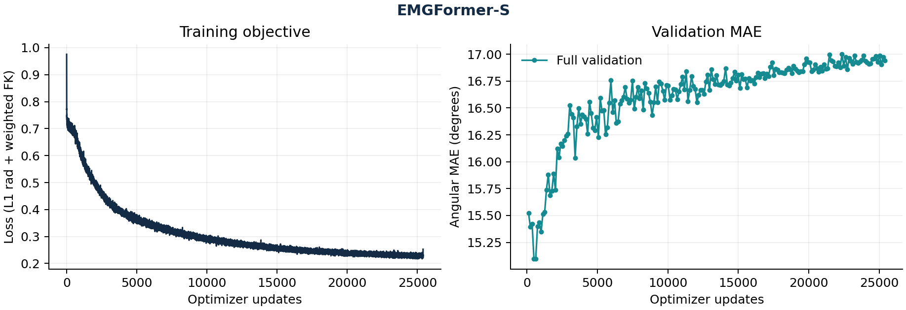
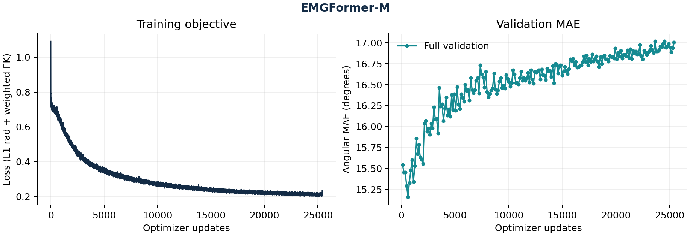

# 已完成实验：EMGFormer-S / M

截至 2026-10-25，E1（EMGFormer-S）和 E4（EMGFormer-M）均完成 200 epochs、25,400 次更新、独立完整验证选模、原训练器最终测试及锁定检查点中心复算。下表是本项目的实际 legacy 结果，误差越低越好。ResNet-18 仍在完整训练，融合尚未完成；**E1–E4 整体复现与全论文定量复现尚未完成。**

| 模型 | 全部中心 MAE (°) | 有图中心 MAE (°) | EMG 轨迹 MAE (°) | 验证选中更新 |
| --- | ---: | ---: | ---: | ---: |
| [EMGFormer-S](emgformer-s/metrics.md) | 16.313757 | 16.276525 | 16.289435 | 635 |
| [EMGFormer-M](emgformer-m/metrics.md) | 16.490835 | 16.453937 | 16.486140 | 635 |

全部中心指标来自原训练器最终测试，并由一次锁定中心复算按 **MAE 绝对容差 0.0001°、有效角度计数精确相等**逐组核对；有图中心来自这同一次复算的 `crop_present` 子集。轨迹指标来自原训练器最终测试，锁定产物检查核对了轨迹分母，**没有额外运行一次轨迹推理**。S 成功的原复算产物经身份核验后接纳，未重放 S 推理；M 后续独立复算完成。审计不参与选模或调参。

两个模型共享相同测试请求、划分、归一化和 crop-present 人口，完整身份与共同人口摘要见 [publication-manifest.json](publication-manifest.json)。上表为按有效角度加权的 pooled MAE；逐用户均值及总体标准差另见各 `audit.json`，不能与 pooled MAE 或论文条件统计混算。

两条完整曲线均表现为训练损失继续下降、验证误差在早期最低点后上升；最终测试使用验证选出的第 635 次更新，不能用最后一轮替代。这是当前配方存在过拟合的迹象；本次仅运行 seed 42，S/M 的误差差异不足以证明跨随机种子的优劣，也没有据测试结果重新调参。

| 采样／人口 | 双手中心请求 | 有效角度数 | 无效角度数 |
| --- | ---: | ---: | ---: |
| 全部中心 | 2,792 | 59,572 | 1,852 |
| 有图中心 | 2,688 | 59,132 | 4 |
| EMG 完整轨迹 | 2,792 个窗口，每窗对齐 11,490 点 | 684,715,272 | 21,046,488 |

全部中心中有 **104** 个请求缺少对应裁剪；这些请求仍保留在全部中心统计中。原 JSON 保留弧度绝对误差和、有效分母、逐手、逐 split、手指／腕角、匿名逐用户记录，支持重新计算度数指标。

## 完整产物

| 模型 | 原严格导出 | 锁定中心复算 | 训练／验证曲线 |
| --- | --- | --- | --- |
| EMGFormer-S | [JSON](emgformer-s/metrics.json) · [Markdown](emgformer-s/metrics.md) | [audit.json](emgformer-s/audit.json) | [PNG](emgformer-s/training-curves.png) · [SVG](emgformer-s/training-curves.svg) |
| EMGFormer-M | [JSON](emgformer-m/metrics.json) · [Markdown](emgformer-m/metrics.md) | [audit.json](emgformer-m/audit.json) | [PNG](emgformer-m/training-curves.png) · [SVG](emgformer-m/training-curves.svg) |

所有报告与审计 JSON/Markdown 保留原字节。`metrics.md` 保留导出当时的 `--no-plots` 和待审计提示；后续审计结论以本页及对应 `audit.json` 为准。曲线复用由逐字节相同 `metrics.json` 绘制并检查过的产物，图中训练损失与验证 MAE (°) 分列展示，不是同一种量。

### EMGFormer-S

### EMGFormer-M

## 科学边界

这是官方 legacy 发布兼容实验。41 份记录中有一份不足完整窗口，实际测试覆盖 **40 名用户**；发布标签中的 User、Both 条件分别与训练窗口有 **1 名用户交集**，不能称为严格未见用户测试。整 episode FFT 预过滤仍有跨时间依赖；本实验采用 12,000 点输入，而 PDF 描述为 7,790 点。数据、标签、滤波、输入和配方与 PDF 原表的精确等价性仍未证明。

全部限制、E2/E3 尚欠要求及论文扩展范围见[复现覆盖矩阵](../../docs/reproduction-matrix.md)，当前进度见[运行状态](../../docs/run-status.md)。本目录只发布脱敏汇总、匿名用户序号和内容摘要，不发布原始参与者标签或映射、机器路径、原始协议文件、数据及权重。
