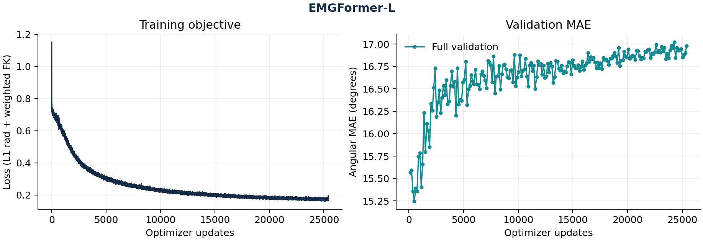

# EMGFormer-L：新增 legacy 完整实验

2026-10-26 已完成200 epochs、25,400次连续更新和200次完整独立验证，随后原训练器最终测试、严格导出及一次锁定中心复算均退出成功。实际运行来源保持 `7b805d428957e62cc93ff48f34e954c64159691e`；控制器于09:21:57 UTC完成。

| 测试人口 | 中心请求 | 有效角度数 | MAE (°) |
| --- | ---: | ---: | ---: |
| 全部中心 | 2,792 | 59,572 | 16.612111 |
| 有图中心 | 2,688 | 59,132 | 16.571878 |

独立完整验证的最小轨迹MAE为15.245916°，所选best在第508步（第4轮）。最终测试使用验证选中的best，没有用最后一轮替代。104个缺crop请求仍保留在全部中心统计。原bfloat16、matmul high、batch500下的锁定中心复算，全部14个基准分组均满足MAE绝对容差0.0001°、有效角计数精确相等；测试不参与选模。

原训练器最终测试的完整轨迹MAE为16.591133°，有效角度数684,715,272。独立锁定审计仅重新累计中心指标，**没有额外复算整段轨迹MAE**；有图中心来自同次中心审计的crop-present子集。轨迹、全部中心及有图中心各用自己的分母，不能混算。

原[metrics.json](metrics.json)、[metrics.md](metrics.md)、[audit.json](audit.json)保持服务器严格导出的原字节；[独立发布清单](publication-manifest.json)记录实际来源、环境、身份和五个成功阶段。曲线从同一metrics.json生成，原metrics.md中的历史no-plots提示保留。旧四模型与RN50、RN152的产物和发布清单均不改写。

L按原配置随机初始化，构造模型前seed42。实际使用声明的legacy配方：指尖系数0.01不同于固定官方Hydra两个别名合成的0.02，见[损失审计](../../official-loss-audit.md)；单卡、batch500、6个数据worker、bfloat16和数据适配保留真实身份，不声称官方字面训练或多rank等价。200轮是本次配置的实际完成记录，不能由此推成已保留官方所有回调行为。

旧队列输入12,000点，测试实际40名发布用户，User/Both各有一名用户也在训练窗口中；整episode预过滤、标签来源与PDF7,790点输入和4,278测试手样本的差异仍在。仅seed42，不作跨seed优劣结论，论文原表精确等价性未证明。验证最低点后曲线明显上升，完整训练完成不消除该配方过拟合的迹象。

完整训练子进程墙钟28,602.418367秒，包含其验证、保存和最终测试，排除准备、短验收、导出及独立中心审计；不是GPU kernel时间或论文GPU-hours的等价测量。本目录只是该项legacy实验的结果，不代表全文任务完成。
