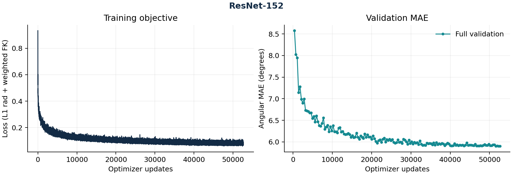

# ResNet-152：新增 legacy 完整实验

2026-10-26 已完成150 epochs、52,650次连续更新和150次完整独立验证，随后原训练器最终测试、严格导出及一次独立锁定中心复算均退出成功。运行来源保持 `a357423b722b8df3e15b78b88b897c6087a04884`；控制器于08:20:22 UTC完成。

| 测试人口 | 中心请求 | 有效角度数 | MAE (°) |
| --- | ---: | ---: | ---: |
| 全部中心 | 2,792 | 59,572 | 5.982738 |
| 有图中心 | 2,688 | 59,132 | 5.869706 |

独立完整验证的最小中心MAE为5.900450°，所选best在第52,650步（第150轮），恰与最终轮一致；没有用last替代验证选模。104个缺crop请求仍保留在全部中心统计。原bfloat16、matmul high、batch180下独立复算的全部14个基准分组，在MAE绝对容差0.0001°、有效角计数精确相等的门槛内一致，有图子集也一致。测试不参与选模。

原[metrics.json](metrics.json)、[metrics.md](metrics.md)、[audit.json](audit.json)保持服务器导出的原字节；[独立发布清单](publication-manifest.json)记录来源、环境、身份与五个成功阶段。曲线从同一metrics.json生成并检查，原metrics.md中的历史no-plots提示保留。旧四模型与RN50的发布清单不改写。

这是声明的legacy派生配方：固定官方版本缺独立RN152 YAML，从RN18配方显式更换backbone，实际使用ImageNet1K_V1权重。指尖系数0.01与官方双别名合成的0.02仍不同，见[损失审计](../../official-loss-audit.md)；单卡批量、精度、回调和数据适配保留原身份，不声称官方字面训练等价。

旧队列输入12,000点，测试实际40名发布用户，User/Both各有一名用户也在训练窗口中；整episode预过滤、标签来源、与PDF7,790输入及4,278测试手样本的差异仍在。只有seed42，不作多seed结论；视觉模型没有轨迹成绩。

完整训练子进程墙钟23,070.334986秒，含其验证、保存和最终测试，排除准备、短验收、导出及独立审计；不是GPU kernel时间或论文GPU-hours的等价测量。
