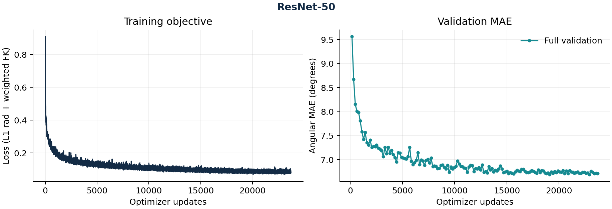

# ResNet-50：新增 legacy 完整实验

2026-10-26 已完成 150 epochs、23,700 次连续更新和 150 次完整独立验证，随后原训练器最终测试、严格导出和一次独立锁定中心复算均退出成功。运行代码固定为 `a357423b722b8df3e15b78b88b897c6087a04884`，没有用后续开发头替换训练身份。

| 测试人口 | 中心请求数 | 有效角度数 | MAE (°) |
| --- | ---: | ---: | ---: |
| 全部中心 | 2,792 | 59,572 | 6.640058 |
| 有图中心 | 2,688 | 59,132 | 6.535572 |

缺少 crop 的 104 个请求仍保留在全部中心中。按完整独立验证的全部中心 MAE 选出第 19,118 次更新（第 121 轮），最佳验证 MAE 为 6.690380°。独立复算保持原 bfloat16、matmul high、batch400 与冻结人口；全部 14 个基准分组在 MAE 绝对容差 0.0001°、有效角度计数完全相等的门槛内一致，有图子集也一致。测试没有参与选模。

原 [metrics.json](metrics.json)、[metrics.md](metrics.md) 和 [audit.json](audit.json) 保留服务器导出的原字节；[发布清单](publication-manifest.json)记录哈希、环境和实际控制阶段。图由同一份未修改 metrics.json 绘制，metrics.md 中的历史 `--no-plots` 提示保留。原四模型的文件与 publication-manifest.json 不改写。

此项是已声明的 **legacy 派生配方**，使用指尖系数 0.01；固定官方 Hydra 双别名实际归约为 0.02，见[损失审计](../../official-loss-audit.md)。官方固定版本没有独立 RN50 YAML，本项目从 RN18 配方显式更换 backbone，并使用真实 ImageNet1K_V1 主干。单卡批量、精度、训练器回调与数据适配均保留原身份，不能称官方字面训练等价。

队列为旧 12,000 点网格；实际测试 40 名发布用户，User/Both 标签各有一名用户也在训练窗口中。整 episode 预过滤、标签生成来源、与 PDF 人口/7,790 点输入的差异仍存在；2,792 个手中心不是论文的 4,278。只有 seed42，无多 seed 结论。视觉模型不产生轨迹成绩，跨用户标准差也不能与 pooled MAE 混用。

控制器记录完整训练阶段从 01:55:27.116350 到 05:48:04.286082 UTC，耗时 13,957.169732 秒。该墙钟区间含该子进程的训练、验证、保存和最终测试，不含依赖准备、短验收、导出及独立审计，也不是 GPU kernel 时间或论文 GPU-hours 的等价测量。
