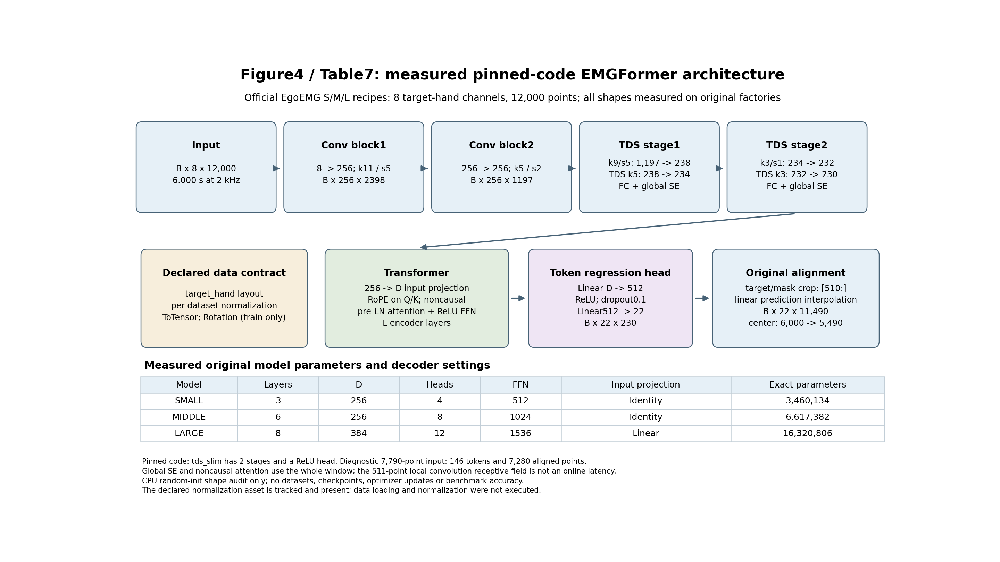

# EMGFormer 官方架构与参数实测：Figure4 / Table7

2026-10-28完成原工厂CPU结构核验。固定官方提交 `f7cbd048b7092139852270491d3859cd472e0311`，分别原样合成 `emgformer/egoemg_emgformer_{small,middle,large}`，在seed42设置后调用官方 `make_lightning_module`。本项没有加载数据或检查点，没有优化器更新或CUDA初始化；随机模型的形状核验不产生新的论文精度结果。

- [原始机器可读核验](emgformer-architecture.json) · [执行与产物摘要](emgformer-architecture-execution.json)
- [SVG](emgformer-architecture.svg) · [PNG](emgformer-architecture.png)
- [独立分析脚本](../../scripts/paper/audit_emgformer_architecture.py)



## 原始模型参数

| 官方配置 | Transformer层数 | 宽度 | 注意力头数 | FFN | 256→宽度投影 | 总参数 | 可训练参数 |
| --- | ---: | ---: | ---: | ---: | --- | ---: | ---: |
| small | 3 | 256 | 4 | 512 | Identity | 3,460,134 | 3,460,134 |
| middle | 6 | 256 | 8 | 1024 | Identity | 6,617,382 | 6,617,382 |
| large | 8 | 384 | 12 | 1536 | Linear | 16,320,806 | 16,320,806 |

以上是实际构造后逐参数计数，不是把论文3.5M/6.6M/16.3M抄成实测值。M的6,617,382另与此前独立GPU集成记录对账一致；初始化状态摘要绑定于JSON，六次前向均未改变模型状态。这里是EgoEMG的8输入通道/22角模型，不能替代EMG2Pose的16通道/20角参数量。

## 时间路径与原生对齐

三个原样配方均为目标手8通道、训练及评价12,000点；train stride1,200、val/test stride12,000。2kHz下该窗口是6秒。前向hook实际测得：

| 阶段 | 时间点/token数 |
| --- | ---: |
| 输入 | 12,000 |
| 初始Conv，k11/s5 | 2,398 |
| 第二Conv，k5/s2 | 1,197 |
| Stage1输入Conv，k9/s5 | 238 |
| Stage1 TDS，k5/s1 | 234 |
| Stage2输入Conv，k3/s1 | 232 |
| Stage2 TDS，k3/s1 | 230 |
| token回归头 | 230 × 22 |
| 原生预测插值与标签裁剪 | 11,490 × 22 |

原模型 `left_context=510,right_context=0`，标签和布尔mask均精确等于原输入的 `[510:]`；原生 `BaseModule.forward` 将预测线性插值到11,490点。输入中心6,000对应裁剪后5,490。S/M直接接256维，L另有256→384的Linear。原张量维序、dtype、hook形状与有限值检查保留在JSON。

还分别以7,790点做一次明确标注的诊断前向，实际146tokens、对齐7,280点；它不是这三个EgoEMG配方的输入配置，也不是新的训练实验。六次前向为三模型各两种长度，不能计作六个复现模型。

## 官方源码优先的裁决

- **窗口和通道：** PDF中7,790samples/7790ms、8/16通道描述互有歧义；这三个固定官方EgoEMG配置的实际行为是12,000samples和8目标手通道。7,790点仍是其他visual/classic/EMG2Pose配方的设置，不能一律替换。此前把所有旧版12,000点都概括为不同于官方输入过于宽泛，现予更正；旧实验的数据、归一化、损失与回调差异仍然存在。
- **前端和注意力：** 实际 `tds_slim` 为两次初始Conv和两个TDS stage，SE是global；Transformer为pre-LN、RoPE Q/K、ReLU FFN，`causal=false`。511点只是局部卷积感受野；全窗SE与非因果注意力令其不能作为在线延迟证明。
- **回归头：** 实际为Linear→512→ReLU→Dropout0.1→Linear22，遵循源码；PDF图示GELU只作为差异记录。
- **归一化和数据：** 配置声明per-dataset，并引用 `per_dataset_norm_stats_repro_filtered_paper_alias.json`。该文件确实随固定Git版本提供，SHA256为 `d4b73febf386ec7b2028639eed8bbd7363d13cbe3fe489149915bcef071ee96a`；原型图中“文件缺失”的说明已经纠正。本项只核验存在性、Git跟踪和摘要，没有运行实际归一化，也没有因此补齐unified所需EgoEMG/ShowEE/Incre训练来源。
- **训练声明：** 原合成配置为batch500、bf16、AdamW5e-5/weight_decay0.01、cosine200至1e-5；val_mae/min选top3+last，early-stop patience200。两个指尖别名各0.01的实际合成行为另由[损失审计](../official-loss-audit.md)证明有效0.02。本项没有实际执行这些训练声明，不把它们追写为旧实验已使用的配方。

## 核验与边界

本机Python3.12.14、Torch2.2.2+cpu、Lightning2.5.0.post0；六次原始工厂CPU前向实际exit0，目标/布尔mask裁剪及FP32类型、全有限值、初始化状态不变检查通过。固定源/config/归一化资产前后摘要一致；PNG/SVG重复生成逐字节相同，并已目视检查版面。原生Transformer给出的nested-tensor性能警告保留，不改变结果或跳过检查。

Table7的架构和参数列由本项支撑；实际完整训练用时、GPU数/型号/精度与验证开销仍需各实验自己的记录。CPU形状、短GPU验收或共享A800墙钟不能填写论文4090 GPU-hours。Figure4在此为按实际源码重新绘制的解释图，不宣称复刻原论文每个图形元素或完成PDF全部增强。全文与官方新配方训练均未因本项完成而完成。

在已配置固定依赖的环境中，复核命令为：

```bash
CUDA_VISIBLE_DEVICES='' OMP_NUM_THREADS=2 MKL_NUM_THREADS=2 python scripts/paper/audit_emgformer_architecture.py probe --upstream upstream --output /tmp/emgformer-architecture-audit.json
python scripts/paper/audit_emgformer_architecture.py render --input /tmp/emgformer-architecture-audit.json --output /tmp/emgformer-architecture-figure
```

probe拒绝覆盖已有结果，复跑须使用新的输出文件；无需下载权重或数据。
