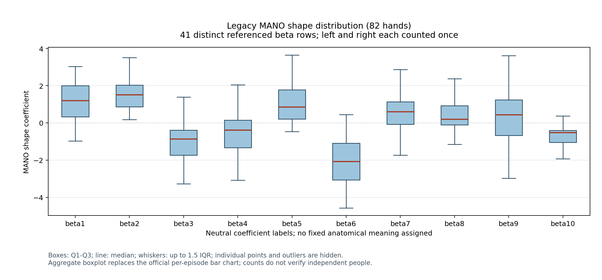

# Legacy MANO shape statistics

41 metadata episodes reference 41 distinct beta rows; 41 left + 41 right = 82 hands.

Population standard deviation uses ddof=0. Percentiles use the linear method.

| Dimension | Mean | Std | Min | Max | range (max - min) | P5 | P95 | P95-P5 |
| --- | ---: | ---: | ---: | ---: | ---: | ---: | ---: | ---: |
| beta1 | 1.086740 | 1.050931 | -0.965964 | 3.034078 | 4.000043 | -0.632405 | 2.526811 | 3.159216 |
| beta2 | 1.504564 | 0.793004 | 0.183189 | 3.506083 | 3.322894 | 0.215725 | 2.921044 | 2.705320 |
| beta3 | -0.980956 | 1.076358 | -3.803642 | 2.547081 | 6.350723 | -2.564373 | 0.722542 | 3.286915 |
| beta4 | -0.536567 | 1.068839 | -3.077267 | 2.050355 | 5.127623 | -2.160611 | 1.147719 | 3.308329 |
| beta5 | 1.053827 | 0.996423 | -0.460908 | 4.638143 | 5.099051 | -0.111588 | 2.584068 | 2.695656 |
| beta6 | -2.269289 | 1.710631 | -10.252831 | 0.449666 | 10.702497 | -5.936638 | -0.205552 | 5.731086 |
| beta7 | 0.727393 | 1.437338 | -1.734881 | 8.253786 | 9.988667 | -1.075476 | 3.007348 | 4.082824 |
| beta8 | 0.371477 | 1.000004 | -1.802199 | 4.683078 | 6.485277 | -1.007400 | 1.932287 | 2.939687 |
| beta9 | 0.364870 | 1.464089 | -2.977867 | 5.343985 | 8.321852 | -1.768066 | 2.723044 | 4.491110 |
| beta10 | -0.738506 | 0.553010 | -3.308431 | 0.365826 | 3.674257 | -1.844808 | -0.091719 | 1.753089 |

Counts describe episodes and distinct referenced beta rows, not verified independent people.
Official code computes range (max - min); the paper PDF labels the corresponding column P95-P5. These are different statistics.
Actual P5, P95 and P95-P5 are separately reported using linear percentiles; values are not adjusted to match the PDF.
The requested aggregate boxplot replaces the official per-episode bar chart. Individual points and outlier markers are hidden.
beta1 through beta10 are neutral MANO coefficient labels; no fixed anatomical meaning is assigned.

PDF Table 5 (page 16): 48/50 entries match at three decimal places when the final column is interpreted as official range.

- beta6 range: computed 10.702497482 (three decimals: 10.702); PDF: 10.703.
- beta10 mean: computed -0.738506138 (three decimals: -0.739); PDF: -0.738.

Differences are retained; their cause is not established.

Comparison reference: supplied PDF SHA256 `124318dce75d9af00ab4d8427acf01315cf83ae1992082b783d5a488c2474725`; fixed Table 5 transcription.

Content identities (SHA256):

- manifest.json: `ebcef7877444253869845b9337b7c0df2b16b0b6f55d83c58d6c3c03bae8ac09`
- metadata.npz: `cb42886b5ca80a070d3b79f5e920cd01e364572e038ef11d5643e9ab73528a57`
- acquisition_ledger.json: `764163c27a77135adea7a66e626f9e23ed7aab34121a95a820a8c27fbf9e8ab2`
- scripts/paper/plot_beta_diversity.py: `c7c6179f06185954096ec32e97ce93f72dcaffa8d8276dfa78bca9b8c4eddc72`
- egoemg_repro/dataset_statistics.py: `e61c383d8d7ea48717e8dca56c5506f8ab3c2fb1396707d506f0e570e8ee2d11`
- generated_mano_left_beta.dat (41 x 10, float32): `cfc2b56a47e5a912cfd03e576a27920fb2c43a0152fc73e28b74f5ac9063d865`
- generated_mano_right_beta.dat (41 x 10, float32): `48e6889f51db4cb45623731f7ae98a79f2d6498fa45048abb0b7c3fbd6af2628`

Acquisition hashes verify local transfer integrity; publisher authenticity is unverified.
Official source revision: `f7cbd048b7092139852270491d3859cd472e0311`.

