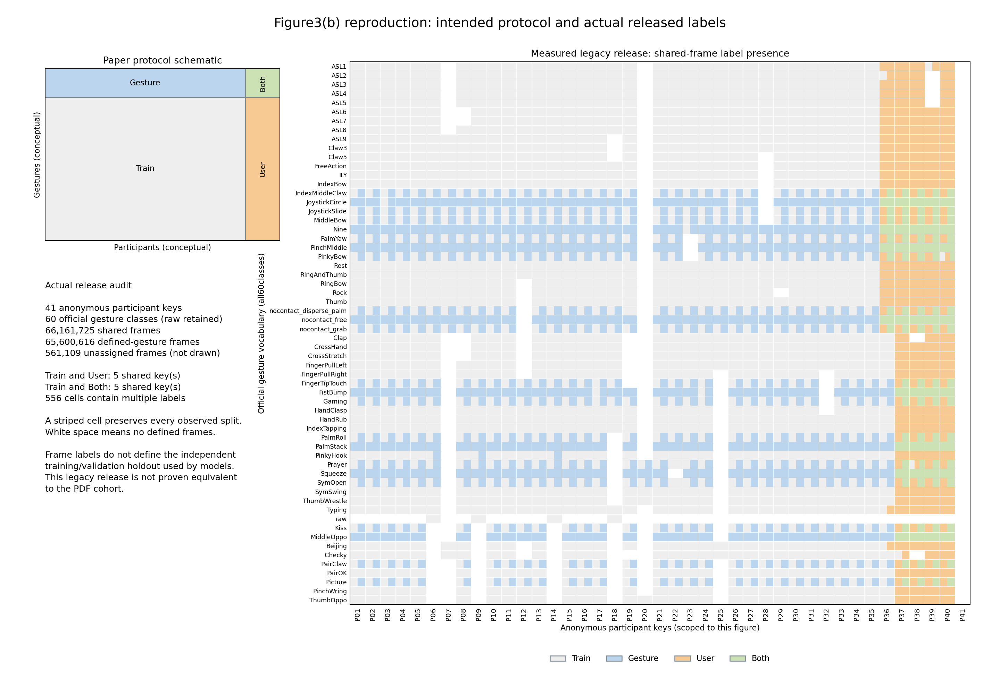

# Figure3(b)：协议示意与实际发布标签矩阵

左图重绘论文p.5的划分概念；右图由真实旧版发布数据完整扫描生成，保留全部60类（含raw）。两者分别标为示意和实测，不将理想矩形分区强加给发布标签。固定官方版本为`f7cbd048b7092139852270491d3859cd472e0311`；其paper绘图脚本没有提供这张split diagram的生成入口，本项目补充独立生成脚本。



| 全帧统计 | 实测 |
| --- | ---: |
| 元数据参与者键 | 41 |
| 含定义手势帧的键 | 40 |
| 共享同步帧（双手只计一次） | 66,161,725 |
| 定义手势帧 | 65,600,616 |
| 未分配帧（图中不画） | 561,109 |
| 同一参与者/手势有多个split的格子 | 556 |
| Train∩User / Train∩Both参与者键 | 5 / 5 |

每个格子表达标签是否出现；有多个标签时并排显示全部颜色，条纹宽度不表示帧数比例。相对每格最大标签，其他标签共有1,537,951帧（定义手势帧的2.3444%），完整分母在JSON中保留。41个元数据键中有1个没有定义手势帧，矩阵相应列保持空白。P01–P41只在此图有效，原ID映射及匿名排序密钥仅私下保存，不与模型报告P编号联结。

| 发布标签 | 定义手势帧 | 出现过该标签的参与者键 |
| --- | ---: | ---: |
| train | 48,956,244 | 40 |
| user | 6,399,890 | 5 |
| gesture | 8,984,573 | 36 |
| both | 1,259,909 | 5 |

这里的5/5是完整共享帧的label存在性，不是模型窗口中心或独立训练/验证/测试的交集。早期窗口中心实验记录的1/1保持原范围；不能用这张图回写其人口或错误率，也不能声称这份旧发布满足PDF的严格未见用户设计。活动标签不是关节有效性mask。本图没有新增训练或模型误差。

三字段所有396,970,350字节重新计算SHA256，分别等于已保存的传输/全帧审计身份；每个class/split/active计数与先前全帧审计完全一致，且另与公开coverage逐类、逐split对账。元数据边界连续覆盖所有行，源文件身份在扫描前后稳定。真实受管理CPU扫描actual exit0，用时1.688242秒；父进程不导入Torch、不注入资源观测，三个实际进程身份已独立确认退出。仅传输身份不构成发布者签名认证。

公开匿名聚合JSON可直接重复渲染，同一环境下两次PNG/SVG逐字节一致：

```bash
python scripts/paper/render_release_split_matrix.py render \
  --input results/dataset-statistics/split-matrix.json \
  --output results/dataset-statistics/split-matrix
```

重新扫描使用脚本的`scan --help`；需本地发布数据、已有frame审计和gesture-vocabulary，输出匿名聚合与独立私有目录。重新扫描会生成新的匿名排序，公开渲染则复用当前固定匿名行。原始数据与私有映射均不随仓库发布。

- [匿名计数JSON](split-matrix.json) · [矢量SVG](split-matrix.svg) · [实际执行及产物摘要](split-matrix-execution.json)
- [生成脚本](../../scripts/paper/render_release_split_matrix.py) · [既有全帧覆盖](../dataset-semantics/coverage.md) · [中心覆盖范围](../dataset-semantics/center-coverage.md)
