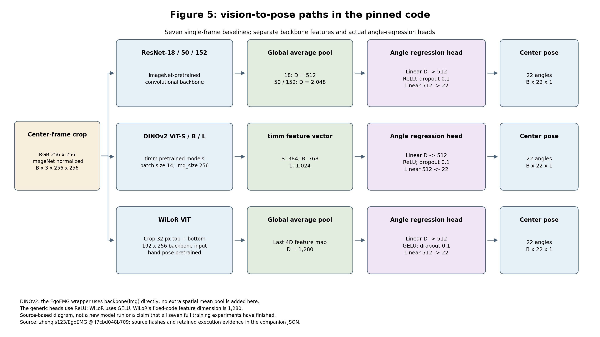
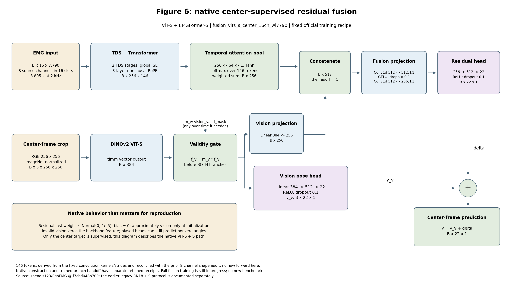

# Figures 5 / 6：按固定官方源码重绘的模型结构

固定上游 `f7cbd048b7092139852270491d3859cd472e0311`。这两张图是描述性结构复现，遵循已批准的“歧义以官方代码为主”；不是 PDF 的逐像素重绘，也不代表七种视觉模型或融合训练全部完成。本次只做静态源码核对和绘图，新增模型构造、前向、数据读取和优化更新均为 0。

## Figure 5：七种单帧视觉基线



[SVG 矢量图](vision-architecture.svg)。输入接口为中心帧 RGB crop `[B,3,256,256]`，由数据端提供 ImageNet 标准化图像；最终均输出 `[B,22,1]` 的中心姿态。图只描述单帧配置，不将可选多帧代码路径混入。

| 模型 | 主干特征维度 D | 主干后的处理 | 回归头 |
|---|---:|---|---|
| ResNet-18 | 512 | 全局平均池化、flatten | D→512→22，ReLU，dropout 0.1 |
| ResNet-50 / 152 | 2,048 | 同上 | 同上 |
| DINOv2 ViT-S / B / L | 384 / 768 / 1,024 | 直接使用 `timm backbone(img)` 返回的向量 | D→512→22，ReLU，dropout 0.1 |
| WiLoR ViT | 1,280 | crop 上下各裁 32 像素，主干输入为 192×256；取返回值中最后一个 4D 特征图，再全局平均池化 | D→512→22，GELU，dropout 0.1 |

原图用通用 GELU 头示意；固定源码的 ResNet/DINOv2 实际用 ReLU。DINOv2 的 EgoEMG 包装层没有再加一个空间平均池化。WiLoR 维度按实际 `Linear(1280,512)`，不采用原文附录的 1,576 维描述。图中的预训练身份是模型配方；实际初始化/训练证据仍分别见各模型报告，不能由这张图替代。

原始实现：[ResNet](https://github.com/zhenqis123/EgoEMG/blob/f7cbd048b7092139852270491d3859cd472e0311/egoemg/models/modules/resnet_vision.py)、[DINOv2](https://github.com/zhenqis123/EgoEMG/blob/f7cbd048b7092139852270491d3859cd472e0311/egoemg/models/modules/vit_vision.py)、[WiLoR](https://github.com/zhenqis123/EgoEMG/blob/f7cbd048b7092139852270491d3859cd472e0311/egoemg/models/modules/wilor_vit.py)、[维度常量](https://github.com/zhenqis123/EgoEMG/blob/f7cbd048b7092139852270491d3859cd472e0311/egoemg/models/modules/_vision_constants.py)。

## Figure 6：原生 ViT-S + EMGFormer-S 中心监督融合



[SVG 矢量图](fusion-architecture.svg)。依据官方 `fusion_vits_s_center_16ch_wl7790` 训练配方和 `center_supervised` 实际执行路径：

1. 8 个源 EMG 通道按原映射放入 16 个位置，缺位补零，输入 `[B,16,7790]`。7,790 是采样点数，在 2 kHz 下为 3.895 秒。
2. 两个 TDS stage/global SE 和三层非因果 RoPE Transformer 得到 `[B,256,146]`。146 由固定卷积核/步长计算，并与先前 **8 通道**诊断前向对账；本次没有新做 16 通道前向。
3. 时间注意力为 `Linear256→64 / Tanh / Linear64→1`，沿时间 softmax 并加权求和，得到 `[B,256]`。
4. DINOv2-S 返回 `[B,384]`。`vision_valid_mask` 有时间维时先 `any`，再乘到视觉特征，之后才分别进入视觉姿态头和 384→256 投影。特征归零不保证角度归零，因为后续层有偏置。
5. EMG 和投影视觉特征拼为 `[B,512,1]`，经过 `Conv1d512→512(k1) / GELU / dropout0.1 / Conv1d512→256(k1)` 和 ReLU MLP 残差头。最后输出 `y = y_v + delta`，仅监督中心目标。
6. 残差头最后一个 Linear 的权重为 `Normal(0,1e-5)`、偏置为 0；因此初始化时近似视觉预测，不能宣称严格零残差等价。

[先前原生构造状态](../native-fusion-construction-initialization-20261028.json)的投影、池化和两个 head 权重形状已逐项对账，参数 25,855,037。该工程构造使用的随机 EMG 初始化不冒充已训练初始化；[完整训练首轮证据](../native-fusion-full-first-epoch-20261028.json)另外证明实际训练分支交接及新进程重开：EMG 完成 150 轮并选验证 best epoch133，视觉使用完成 124 轮的 **last**，遵循原加载行为。完整融合训练及最终测试尚未完成。此前 legacy RN18+S 的 12,000 点、数据/初始化适配和成绩仍保留独立身份，不由本图追溯证明等价。

原始实现：[融合类与残差初始化](https://github.com/zhenqis123/EgoEMG/blob/f7cbd048b7092139852270491d3859cd472e0311/egoemg/models/modules/mid_fusion.py)、[时间注意力池化](https://github.com/zhenqis123/EgoEMG/blob/f7cbd048b7092139852270491d3859cd472e0311/egoemg/models/modules/_pooling.py)、[训练配置](https://github.com/zhenqis123/EgoEMG/blob/f7cbd048b7092139852270491d3859cd472e0311/config/experiment/fusion/fusion_vits_s_center_16ch_wl7790.yaml)。

## 复现与验证

[静态事实与来源](vision-fusion-architecture.json)记录 13 个固定源码/配置文件 SHA、11 个方法/函数区域的 AST 身份、9 个既有执行记录 SHA。核对全部文件与干净的固定 Git 内容一致，并对照原生构造张量形状、原生执行协议和真实训练分支交接。

在仓库根目录使用现有 Python/Matplotlib 运行时：

```bash
python scripts/paper/render_vision_fusion_architecture.py audit --upstream upstream --repo . --output /tmp/egoemg-architecture-facts.json
python scripts/paper/render_vision_fusion_architecture.py render --input /tmp/egoemg-architecture-facts.json --output-dir /tmp/egoemg-architecture-figures
```

`audit` 不覆盖已有事实文件。实际绘图环境为 Python3.12.14、Matplotlib3.9.4、NumPy1.26.4、Pillow11.0.0，使用 DejaVu Sans 和固定 SVG hash salt。[绘图记录](vision-fusion-architecture-render.json)与[独立复现记录](vision-fusion-architecture-validation.json)保留两个实际 exit0：另一进程重做源码审计，事实 JSON 逐字节相同；另一进程重画两张 PNG、两张 SVG 与绘图记录，五件全部逐字节相同。两张 PNG 已实际查看，文字、箭头和分支无裁切/重叠。没有为这项可逆绘图重复模型测试、训练或整体审查。
