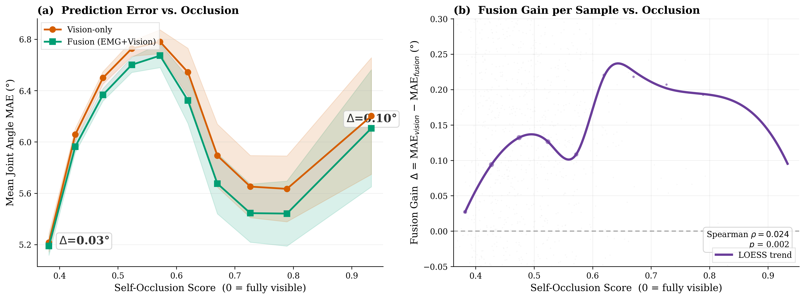

# Figure13：可得旧版 ViT-S 路线完整遮挡分析

全部17,168个唯一手请求的两遍冻结模型预测、独立原始重放、官方统计绘图与新进程报告重建均已结束。7个拥有阶段成功，112个显式拥有／读取进程身份及退出后复核进程确认关闭。[完整执行与退出后证明](../vits-complete-prediction-report-20261101.json)重新核验全部原始批次、来源键／目标／掩码／误差、54文件61.380GB完整输入，以及两份CSV／统计／PNG字节。

**本项完成可得旧版源上的ViT-S分析，不等于论文人口或数值完全复现。** RN18路线仍等待真实兼容初始化与融合训练；数据版本、1920×1080视频回退、原X镜像／未用畸变及训练输入窗口交集仍未证明与论文完全等价。图注未单独标明Figure13的backbone，也不能仅凭同为17,168样本推断同一设置。

## 实际结果

| 项目 | 本次实测 |
| --- | ---: |
| 每遍完整预测 | 17,168手请求／272批 |
| 官方过滤后用于Spearman | 16,650 |
| 官方分箱纳入 | 16,409／10个最终bin |
| 过滤通过但未分箱 | 241，遮挡值均恰为1.0 |
| 过滤人口视觉MAE均值 | 6.473230° |
| 过滤人口融合MAE均值 | 6.353489° |
| 官方CSV的平均融合收益Δ | **0.119740877°** |
| Spearmanρ／p | **0.023640393／0.002283599** |
| 最低／最高有效分箱收益 | 0.027157637°／0.095327586° |
| 最大分箱收益 | 0.220341424°，平均遮挡0.619725 |

融合收益总体为正，但与遮挡只呈**弱正相关**；p值沿用官方逐样本计算，不代表强关系。241个最大右边界样本按官方`[lo,hi)`分箱逻辑不进入bin，仍参与Spearman。缺图695、无效标签518、零姿态GT518均保留在完整预测与原始底表中，没有按误差或可见性另行删样本。

MAE按官方遮挡CSV对每样本全部22角取未mask均值，乘57.3并取4位小数。Δ从原始弧度之差另行换算、取整，因此两列已取整MAE均值之差与CSV平均Δ有微小差别。这里的密网格口径不能替代Table3标准网格masked成绩。

## 与论文及源码对照

论文v1第26页正文／图注报告最低与最高分箱Δ为0.24°／0.52°，在遮挡约0.72处最大收益约0.8°；本次收益幅度更小。论文正文／图注的ρ=0.049、p=0.001，与其图内显示ρ=0.033、p=0.000本身不一致；后者只是显示精度，不能解释为p严格为零。本次保持实测ρ／p，不选择其中一组去改写结果。

保持源码的0.05初始bin、最少100样本合并、末bin至少10、样本SEM以及逐样本Spearman。图中沿用原“LOESS trend”标签，实际执行的是按bin样本数加权的三次`UnivariateSpline`，不是LOESS；只有左图SEM带，未补造正文所述右图趋势置信带。原图Δ标注部分覆盖端点标记，未修改官方绘图字节；精确值见分箱底表。

融合来源对应已完成的原生ViT-S+S及实际兼容EMG初始化，不能用新原生200轮S替代该分支。完整密窗口中1,280个手请求与融合训练输入区间相交，中心帧交集为0；已原样保留并披露，不称严格时间输入隔离或同条件论文基准。

## 图表与原始产物

- [官方列CSV](occlusion_fusion_results.csv)；[未舍入弧度误差与窗口键](raw_paired_errors.csv)。
- [分箱均值／SEM](bins.csv)；[完整统计、成员索引与200点样条](statistics.json)；[聚合摘要与逐split／手统计](aggregate-summary.json)。
- [服务器原始已验收报告](report.json)；[拥有控制器的关闭后完成凭据](completion.json)。

七份服务器原始科学产物逐字节保存，私有NPZ／模型／数据与运行日志不再分发。报告和独立重建的五份数值／图片文件SHA完全一致；退出后读者禁止模型和优化器构造，重新核对完整预测原始包、重建CSV／分箱／统计，再完整重读54个输入文件。CPU使用原生FP32、batch64／4workers，无CUDA及新增训练更新。可得旧版流程的验收不增加14个模型架构家族数，全文仍未完成。
