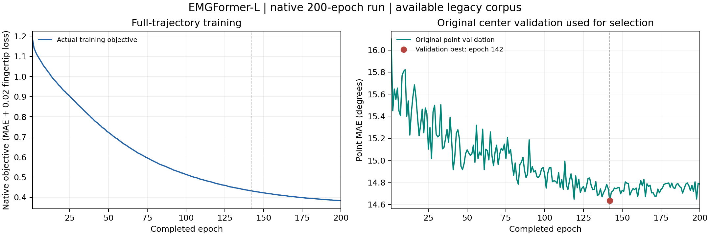

# EMGFormer-L：原生完整轨迹结果

同一个已完成200轮的原生L模型，已完成完整验证／测试的原生前向、独立模型重放、验证冻结、报告及独立原始包核验。七个内部阶段及L外层阶段均成功退出；16个原拥有者、24个原DataLoader进程、2个额外独立读取拥有者关闭。[三规模总关闭凭据](../all-sizes-complete-20261102.json)另证原队列与额外收集器父进程均成功关闭，合计130个不同PID／启动时刻身份退出；逐规模原凭据中父队列可能继续运行的标记保持为当时验收边界。

| 项目 | 实际值 |
| --- | ---: |
| 原模型完整参数量 | 16,320,806 |
| 已完成训练 | 200轮／25,000已保存更新 |
| 原中心验证选优 | 第142轮 |
| 原训练／验证／测试请求 | 62,470／1,052／2,792 |
| 本次每个评价pass | batch500／6workers／BF16 |
| 完整轨迹pooled MAE | **16.5740948764°** |
| 对齐轨迹中心pooled MAE | **16.5054556489°** |
| 轨迹有效角度分母 | 684,769,448 |
| 对齐中心有效角度分母 | 59,532 |
| 测试消费／唯一手请求 | 2,792／2,792 |

所有请求及原始生成掩码保留。原生按batch样本数加权的MAE与有效角度pooled归约分别在[原始报告](metrics.json)；逐手、匿名用户键、split、22角及10个Table12组也在报告内。现有组值为有效角时间pooled，不能直接称为PDF的跨条件按样本加权表。

## 轨迹、中心与选模

12,000点输入，真实左上下文510／右上下文0；230步head输出经原生对齐得到11,490步轨迹。对齐轨迹中心零起算5745，对应原窗口6255；[既有原生点报告](../../original-emgformer/large/README.md)使用6000，其MAE16.573467°独立保留。两种中心不同，不能将差值视作同一帧上的改进。

训练目标仍为完整轨迹；本次沿用原中心验证BEST142，验证分数0.255403995513916rad，BEST SHA `896871c83cb46ac12a755ab4dcee0f89b0995cae8fdcfac6df47ec6820ce1605`。完整fit SHA `cf57d3db07807de24d784bacd6a54ace4830c19dee87b362973b17162ba3b92b`。完整轨迹验证只核对原生／重放一致性，没有重新选权重；先前点测试暴露如实披露。

## 与论文Table2的数值参照

论文L Avg14.2°，本次轨迹16.574095°，描述性差约+2.37°。PDF Avg为跨条件的样本加权，本次为有效角度pooled；旧版数据、来源、人口、单rank与聚合未证明同原表等价。

| 条件 | 论文跨用户mean±SD | 当前跨用户mean±SD（ddof=0） | 当前用户键数 |
| --- | --- | --- | ---: |
| gesture | 11.7±1.5° | 15.293299±1.584466° | 36 |
| user | 15.7±3.0° | 17.819660±1.272192° | 5 |
| both | 17.7±1.1° | 18.313282±1.368923° | 5 |

条件mean±SD对用户键无权平均／总体标准差；总体累加误差和及有效角度，不能平均三项条件均值。用户键不是已经独立确认的自然人身份。

## 来源、硬件与独立验收

固定官方版本`f7cbd048b7092139852270491d3859cd472e0311`，原500／6workers／BF16，有效指尖系数0.02。可得旧版41段、train内独立时间验证及单rank保留；作者EgoEMG／ShowEE／Incre精确合并、完整PDF人口、多卡及多seed未补齐。25,000是封存训练日志链global step，不包含丢弃的中断计算，不能换算为论文独占GPU工时。

[退出后验收](postexit-acceptance.json)用未改变的完整原生读取器重开16个实际输入／16,540,457,757bytes、全部原始预测包及原选定完整状态，实际303.76秒。模型／优化器构造、新学习前向／更新和CUDA均为0；六份原始报告及完成／独立核验文件按服务器原字节导出。

[实际读取器源码](postexit-reader-source.py)按运行字节归档，需配合原private胶囊请求；通用科学入口为[完整轨迹CLI](../../../scripts/paper/run_emgformer_trajectory.py)。[硬件与原时间戳](hardware-and-phase-time.json)记录四个A800/BF16角色pass共18次原前向。时间范围是原函数started_ns至finished_ns，不含CLI入口后的首次输入准入，finished_ns之后还有最终统计／封存及收尾；不是完整CLI时间或神经网络独立FPS。

上游EMG已整episode预过滤，时间切分不能消除滤波依赖；标签仍是发布的generated标签，本次未重生成标注。短训练片段、近似验证比例和用户键重叠等限制见原报告。[历史legacy L16.591133°](../../completed/emgformer-l/metrics.json)及其0.01配方保留，本次0.02不能作跨协议控制变量改进归因。

## 实际200轮曲线

来自全部200条原始epoch记录：左为完整轨迹训练目标，右为原选模的中心验证，完整轨迹测试不参与选优。

[训练CSV](training-history.csv) · [SVG](training-curves.svg) · [绘图来源SHA](training-curves.json) · [原始Markdown](metrics.md) · [完成凭据](completion.json) · [原始独立核验](verification.json)

这完成S/M/L在可得旧版队列上的原生完整轨迹协议；RN18融合、RN152、EMG2Pose、标注／来源和全文其余项目继续，全文尚未完成。
