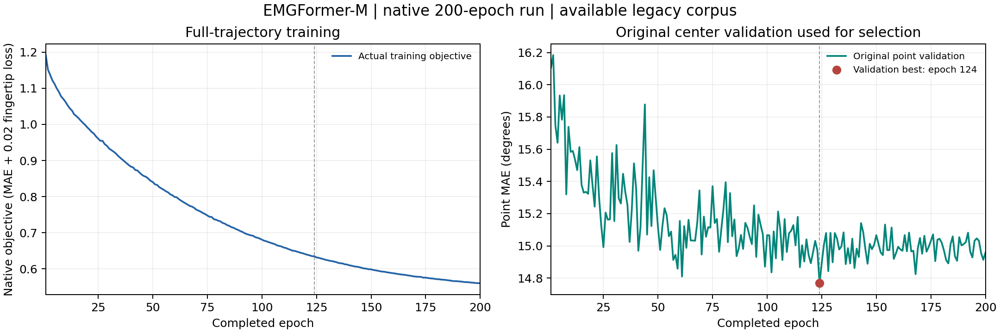

# EMGFormer-M：原生完整轨迹结果

同一个已完成200轮的原生M模型，现已完成完整验证／测试的原生前向和独立模型重放、验证冻结、报告生成及独立原始包核验。七个内部阶段与M外层阶段均成功退出；16个原拥有者、24个原DataLoader进程和额外独立读取器的2个拥有者均关闭。L队列继续运行，不将整个父队列称为已关闭。

| 项目 | 实际值 |
| --- | ---: |
| 原模型完整参数量 | 6,617,382 |
| 已完成训练 | 200轮／25,000已保存更新 |
| 原中心验证选优 | 第124轮 |
| 原训练／验证／测试请求 | 62,470／1,052／2,792 |
| 本次每个评价pass | batch500／6workers／BF16 |
| 完整轨迹pooled MAE | **16.4194180969°** |
| 对齐轨迹中心pooled MAE | **16.3634380700°** |
| 轨迹有效角度分母 | 684,769,448 |
| 对齐中心有效角度分母 | 59,532 |
| 测试消费／唯一手请求 | 2,792／2,792 |

所有请求和原始生成掩码保留，未通过丢弃缺失／无效时间步改变请求队列。原生按batch样本数加权的MAE与有效角度pooled归约分别保存在[原始报告](metrics.json)。逐手、逐用户键、条件、22角、手指及Table12关节组也在报告内；报告里的组值是有效角时间pooled，不直接称为PDF所写的按样本加权表。

## 轨迹与中心定义

原窗口为12,000点；真实模型左上下文510、右上下文0，230步head输出经原生对齐得到11,490步轨迹。对齐轨迹中心为零起算5745，对应原窗口6255；既有原生点读取器的目标中心是6000。两个中心定义不同，不能把数值差当作同一时间点的性能变化。

训练仍使用原完整轨迹目标。模型仍是原中心验证选出的BEST124，验证分数0.25775474309921265rad，BEST SHA为`c9a62af344490dc530a89e4f6b861a5463cd8e9b8aa05fb5380d171776ee36ff`；本次完整轨迹验证只冻结原生／独立重放一致性，没有重新选权重。既有点测试暴露如实披露。[原生中心报告](../../original-emgformer/middle/README.md)及其完整fit SHA、BEST SHA保持不变；原生点MAE16.441148°与本次对齐中心分开。

## 与论文Table2的数值参照

论文EMGFormer-M Avg为14.2°；本次完整轨迹pooled为16.419418°，描述性差值约+2.22°。PDF Avg为跨条件的样本加权均值，本次为有效角度pooled；现有旧版数据、人口、来源、单rank及聚合均未证明与原表等价。

| 条件 | 论文跨用户mean±SD | 当前跨用户mean±SD（ddof=0） | 当前用户键数 |
| --- | --- | --- | ---: |
| gesture | 11.8±1.6° | 15.422465±1.439723° | 36 |
| user | 15.6±1.4° | 17.373135±0.556303° | 5 |
| both | 17.4±0.9° | 17.891525±1.066291° | 5 |

条件mean±SD对用户键无权平均／总体标准差；总体按有效角度累加，不能平均三项条件均值来得到总体MAE。用户键不代表已独立确认的自然人身份。

## 来源与独立验收

固定官方版本`f7cbd048b7092139852270491d3859cd472e0311`和实际完整训练模型，保留原500／6workers／BF16及有效指尖系数0.02。使用可得旧版41段、独立train内时间验证及单rank；EgoEMG／ShowEE／Incre作者合并来源、当前完整人口、原多卡及多seed没有由本结果补齐。训练中断／六域恢复等原证据保留；25,000是完整已保存日志链的global step，不包含丢弃的中断计算，也不能直接换算论文独占GPU工时。

[额外退出后验收](postexit-acceptance.json)用未改变的完整原生读取器独立重开16个实际输入文件／16,540,457,757bytes、全部原始预测包及选定完整状态，实际297.85秒。模型／优化器构造、新学习前向／更新和CUDA均为0；六份完整原始报告／完成标志／独立核验凭据按服务器原字节导出，未改写科学报告内容。

已预过滤EMG覆盖整个episode，时间片分离不能去除上游滤波依赖。标签仍为公开generated标签，本次没有重生成标注；短训练片段、近似验证比例及用户键重叠等原始限制完整保留在报告。

实际[退出后读取器源码](postexit-reader-source.py)按运行原字节归档，需配合其private胶囊请求；原生科学复运行入口为[轨迹CLI](../../../scripts/paper/run_emgformer_trajectory.py)，该归档文件不作为独立的通用命令入口。

[实际硬件与原始时间戳](hardware-and-phase-time.json)记录四个A800/BF16角色pass。时间仅为原函数started_ns到finished_ns：不包含CLI入口前的首次输入准入，finished_ns之后还有最终原始包统计／封存和进程收尾，因此不是完整CLI耗时或独立神经网络FPS。

历史[legacy M完整轨迹16.486140°](../../completed/emgformer-m/metrics.json)的0.01配方和来源完整保留；本次0.02原生结果不替换旧实验，不作跨协议控制变量改进归因。一个架构补充新协议结果不会增加14个模型／表格条目数。

## 实际训练曲线

图来自全部200条原始封存epoch记录；左图为完整轨迹训练目标，右图为用于原选模的中心验证。完整轨迹测试没有参与曲线选优。

[训练CSV](training-history.csv) · [SVG](training-curves.svg) · [绘图来源SHA](training-curves.json) · [原始Markdown报告](metrics.md) · [完成凭据](completion.json) · [原始独立核验凭据](verification.json)

这完成M在可得旧版队列上的原生完整轨迹协议；L、RN18融合、EMG2Pose、标注／来源和整篇论文其余项目仍须继续。
