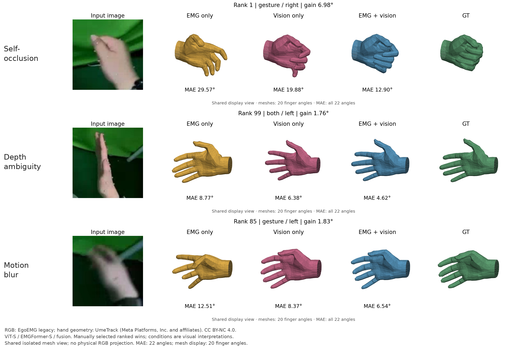

# Figure 7 原生定性比较：旧版 ViT-S 三类样例已核验

可得旧版数据上的 ViT-S／EMGFormer-S／融合三模型普通网格双遍预测、真实追踪过滤、120张候选的独立重建和三类人工选例现已完成。查看[三类图、误差及逐例说明](examples-vits-legacy/README.md)。**RN18兼容融合路线、原论文人口及物理相机等价仍欠；论文 Figure 7 和全文均未全部完成。**

| 人工视觉解释 | 排名 | EMG MAE / ° | Vision MAE / ° | Fusion MAE / ° | Vision − Fusion / ° |
| --- | ---: | ---: | ---: | ---: | ---: |
| 自遮挡 | 1 | 29.57 | 19.88 | 12.90 | 6.98 |
| 深度歧义 | 99 | 8.77 | 6.38 | 4.62 | 1.76 |
| 运动模糊 | 85 | 12.51 | 8.37 | 6.54 | 1.83 |

这些是按未舍入融合收益选出的示例，不是总体优越性的统计证据。三类标签来自人工检查，不是额外传感器真值；运动候选还核对了前后两帧，不能排除失焦／分辨率贡献。所有22角参与FP32未遮罩MAE，乘57.3换算度；网格只显示原始前20角，每姿态0.09归一化、每行共享视角，不能当作物理RGB重投影。未舍入数值、实际RGB、四组姿态和原始／显示网格、选择理由及来源SHA均已保留。

[完整候选索引证明](full-index-double-admission-20261101.json)对应源版本`5100d159229fa36ea5054dafdb898481699e0782`：41段、66,161,725行，RN18／ViT-S × 默认500／全候选0 × 两次独立准入，共8次。18个原始拥有者与独立读取者关闭；三份完整索引输入66,188,232字节、类型化数组及随机状态一致。原始`find_fusion_wins.py`对每个split／手重新初始化seed42，按native_index排序；跨中心split窗口保留。

| 路线 | 每组上限 | 普通步长 | 选中手样本 | 密网格精确交集 | 密网格缺少 | 跨中心split窗口 |
| --- | ---: | ---: | ---: | ---: | ---: | ---: |
| RN18-S | 500，官方默认 | 12,000 | 2,208 | 2,208 | 0 | 652 |
| RN18-S | 0，全部 | 12,000 | 2,792 | 2,792 | 0 | 890 |
| ViT-S-S | 500，官方默认 | 7,790 | 2,322 | 10 | 2,312 | 230 |
| ViT-S-S | 0，全部 | 7,790 | 4,306 | 18 | 4,288 | 482 |

逐组数量见[CSV](candidate-group-counts.csv)。ViT-S密步长是取整后的1,947，7,790不能整除；没有用最近中心借用旧预测。RN18虽网格完全重合，兼容融合模型仍欠，交集本身不授予模型来源许可。

[完整配对输入证明](ordinary-paired-inputs-complete-20261101.json)覆盖默认两路线各两遍，共9,060请求／99,660类型化指纹。退出后用NumPy／Pillow／LMDB从54源文件61,379,659,366字节重建4,530点的49,830个数组，逐项一致；139份源码／请求成员及九项属性核对，10拥有者与读取者关闭。RN18保留89缺裁剪／71无效标签，ViT-S保留80／64；没有因显示条件而预先删除推理点。索引23项、原生配对读取18项、误差排序17项及原始前20角FK适配10项工程检查分别有原始参考证据，见本目录相关JSON。

[真实三模型双遍预测](frozen-predictions-complete-20261101.json)于15:26:14 UTC完整结束：每遍2,322点／38批，保留146步EMG输出的第73下标作为中心。76原始包／760数组、全部10个合并数组及GT／掩码连接独立重建一致；54个完整物理源文件和三检查点再次SHA一致。60个原始拥有者（含48个DataLoader进程）及退出后复核者关闭。模型仍是完整来源的ViT-S last124、独立8通道EMG验证best133、融合验证best108，没有新增训练。

[完整追踪标志证明](boolean-flags-complete-20261101.json)完成四布尔文件2.911GB的两遍准入／导出及退出后重建，6拥有者与复核者关闭。`mocap_head_valid`显式映射到旧版`mocap_webcam_tracked`，`image_head_stale`映射到`image_webcam_stale`，每只手使用21个marker的`any()`；没有拿生成标签或裁剪掩码代替。全部2,322点先预测，条件保留2,242；未追踪20、无手marker64、陈旧0，前两者有重叠。字段映射不证明新版相机／人口等价。

[120候选完整证明](candidate-pool-complete-20261101.json)绑定源`df1b963af48a06d7914d741fe37c986e88a38568`。导出15:45:35 UTC结束；另一个独立、脱离SSH的读取阶段于15:50:23结束，重新从实际输入组装全部120个RGB／姿态／网格／误差，并重画PNG，文件字节完全一致。4个原始导图拥有者、4个独立读取拥有者及最后验收进程均已关闭，364个原始产物和121个独立读取文件均校验。一次先前SSH读取连接中断、仅留下20张临时重建图而没有接受记录；确认原进程退出后改用独立后台读取，该失败没有冒充完成或重跑模型推理。

一次新增集成审查发现输入源码包准入只信任旧bundle字段的缺口，现已修正：[8个回归先失败后通过、最终60项相关pytest通过](review-corrections-20261101.json)，零跳过、网络／优化器构造0、无CUDA。准入现在重算完整manifest主体和每个源码成员，随后持续保护其属性；历史生产源码与当前读取器身份明确分开。真实历史2,322点的预测身份和数组仍能精确读取，历史证据禁止开始新forward；没有为了校验修复重跑已完成的推理、旧数学或数据流程。无待处理Minor，全部审查裁决见该证明。

[运行与导图入口](../../docs/native-qualitative-predictions.md)保留命令。数据为 EgoEMG Authors 的legacy发布（CC BY-NC 4.0）；UmeTrack通用手资产及派生几何继续保留Meta来源和[完整许可](examples-vits-legacy/sources/UmeTrack-LICENSE.txt)。没有分发MANO权重。[原始运行快照](frozen-prediction-running-20261101.json)和[输入运行快照](default-paired-io-running-20261101.json)仅为历史记录，当前以完整证明为准。架构家族仍为既有14个，定性产物不新增完整模型实验。
