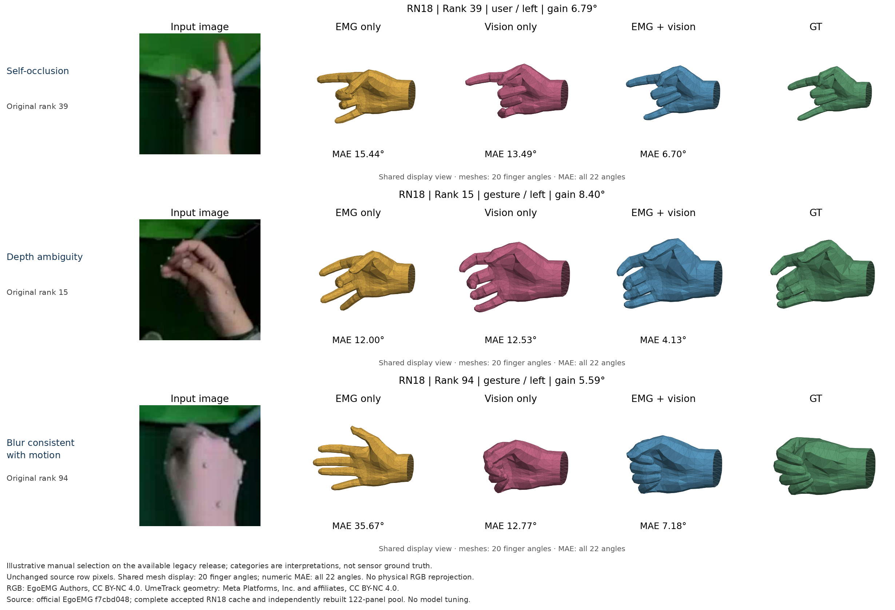
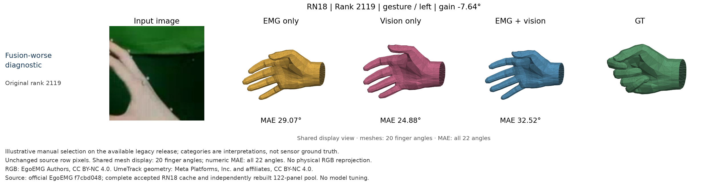

# Figure 7 风格的真实样例：旧版 RN18 路线

本图使用同一实际输入点的 RGB、独立 EMGFormer-S、ResNet-18、两者融合及 GT。**可得旧版发布上的三类人工选例及独立负收益诊断已经验收**；一次新 RN18 整合审查无待修正问题。原论文人口、物理相机及全文等价仍未建立。没有复制论文例图或误差。

| 人工视觉解释 | 原收益排名 | EMG MAE / ° | Vision MAE / ° | Fusion MAE / ° | Vision − Fusion / ° |
| --- | ---: | ---: | ---: | ---: | ---: |
| 自遮挡 | 39 | 15.44 | 13.49 | 6.70 | 6.79 |
| 深度歧义 | 15 | 12.00 | 12.53 | 4.13 | 8.40 |
| 与运动模糊一致 | 94 | 35.67 | 12.77 | 7.18 | 5.59 |
| 负收益诊断 | 2119 | 29.07 | 24.88 | 32.52 | −7.64 |

误差严格保留官方 FP32 的所有22角未遮罩绝对误差均值，再乘57.3。逐例 NPZ、JSON 和[未舍入 CSV](example-errors.csv)保留原数值；选中四点的原生22角误差已从实际姿态重新计算并精确一致。网格只显示原始前20个手指角，两个腕角参与数字但不显示；每姿态按原始规则单独归一化至0.09，每行四个姿态共享显示视角和坐标范围。孤立网格不是RGB的物理重投影；发布的左手RGB已标准化，没有再次翻转。

选例在模型固定后进行：[默认普通网格2,208点](../rn18-cache-source-read-20261105.json)按官方追踪／非陈旧／存在手marker条件保留2,119点，原89个缺crop和71个无效标签未在输入阶段删除。按未舍入 Vision − Fusion 稳定降序，完整排名中1,745点改善、374点变差。人工查看原排名前120个真实RGB和显式1746／2119两张诊断，进一步查看六张完整面板及两组五帧上下文，选择39／15／94作为三类描述性例子。类别允许重叠，不是数据集提供的传感器真值；选中的获益样例不能估计总体效果或隔离EMG贡献，也没有用于模型调参。

自遮挡例中一根手指伸直，其余手指弯曲且相互遮挡；深度歧义例中多个指尖投影重叠，沿视线的间距和屈曲深度难以仅凭单张RGB唯一确定。模糊例的手部上边缘出现拖影，还检查了实际同episode第49305–49309帧的[相邻裁剪](motion-context/motion-context.png)；中心49307帧与模型实际RGB逐像素相同，帧索引的int64输入指纹也一致。邻帧没有参加预测；连续轮廓变化与运动模糊一致，未测快门，不能排除失焦、分辨率或裁剪重采样的贡献。[选择记录](selection.json)保存逐例中文理由、精确窗口键、文件SHA、来源及人工解释边界。

负收益诊断来自全排名的最差 Vision − Fusion 点，显式保留，不与三张获益例混作随机样本。其RGB有部分手部和指尖被裁剪边界截断，但没有证据证明裁剪是失败原因。此例Fusion比Vision差7.64°；不能只凭获益例声称EMG始终有效。关于EMG作用的统计结论应看[同一冻结模型的缺图／置零／时移受控实验](../../visual-missing-emg/README.md)。

真实预测不新增推理，逐点复用已经独立验收的RN18完整11,114点原始双遍结果；2,208个普通网格键／窗口／十一类实际输入指纹完全匹配。模型身份固定为`1bb167a3f47a2b8912e24502b252ebfa81fea2e90c02f11b204259608b88c6ee`，三路实际状态为独立cotrain-S验证BEST74、RN18视觉LAST150、融合验证BEST145。原始[122候选完整证明](../rn18-full-candidate-pool-complete-20261105.json)记录另一独立进程重新准入53文件、逐点读取输入、重建RGB／姿态／原始网格／22角误差／PNG；122套文件字节一致，退出后2,074数组及缓存姿态和像素摘要再次核对，6拥有者和无Torch收集者均关闭。原始纯数值面板中的`trained_source_admitted:false`不被改写：训练来源由上游固定缓存和完整运行证明提供，该面板本身不授予新推理或科学等价许可。

数据RGB来自 EgoEMG Authors 的 legacy 发布，适用 **CC BY-NC 4.0**。原始选择／排序／显示来自[官方固定源码](https://github.com/zhenqis123/EgoEMG/blob/f7cbd048b7092139852270491d3859cd472e0311/scripts/eval/find_fusion_wins.py)。UmeTrack通用手资产和派生几何归 Meta Platforms, Inc. and affiliates，保留[完整许可](sources/UmeTrack-LICENSE.txt)，同为 CC BY-NC 4.0。项目代码许可不改变数据和第三方资产许可，没有分发MANO权重。合成图只在原科研行之外添加标签和来源文字，四张科研行像素全部不变。
