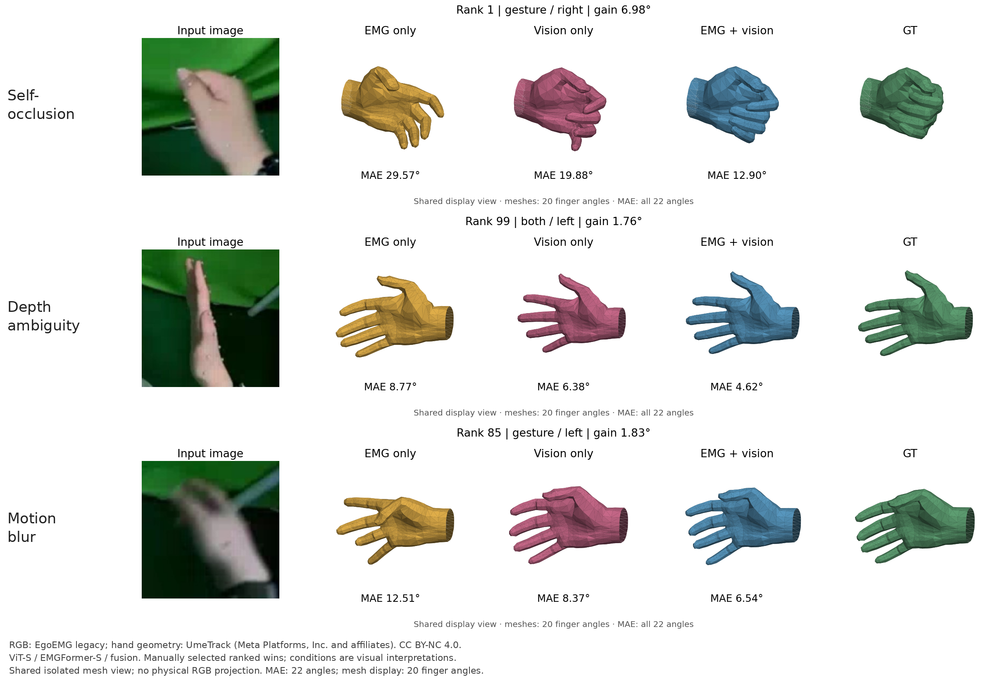

# Figure 7 风格的三类真实样例：旧版 ViT-S 路线

本图使用同一真实输入点的 RGB、EMGFormer-S、ViT-S、两者融合及 GT；完成的是**可得旧版数据上的三类定性样例**，没有复制论文图片或单例误差。[RN18旧版三类样例及失败诊断](../examples-rn18-legacy/README.md)现也已验收；论文人口与物理相机等价仍欠，不能据此宣布论文 Figure 7 或全文全部复现。

| 人工解释的条件 | 原始收益排名 | EMG MAE / ° | Vision MAE / ° | Fusion MAE / ° | Vision − Fusion / ° |
| --- | ---: | ---: | ---: | ---: | ---: |
| 自遮挡 | 1 | 29.57 | 19.88 | 12.90 | 6.98 |
| 深度歧义 | 99 | 8.77 | 6.38 | 4.62 | 1.76 |
| 运动模糊 | 85 | 12.51 | 8.37 | 6.54 | 1.83 |

这里的误差沿用官方 FP32、所有22角未遮罩绝对误差均值，再乘57.3；JSON／[CSV](example-errors.csv)保留未舍入数值，表中仅显示两位。网格采用原始UmeTrack前20个手指角和每个姿态的0.09显示尺寸归一化；两个腕角参与MAE但不显示。每行四个姿态共用显示视角和坐标范围，**孤立网格不代表对RGB的物理重投影**。左手输入是发布的既有标准化裁剪，没有再次镜像。

选例规则在固定模型完成后应用：官方普通网格默认2,322点均先预测，实际 tracking／not-stale／any-marker 条件保留2,242点，再按未舍入 Vision − Fusion 稳定降序。人工检查前120个有真实RGB的候选，选出上述三点；完整排名及索引保留在[sources](sources/)和[候选池完整证明](../candidate-pool-complete-20261101.json)。这是一组经选择的融合获益例子，不能证明总体优越性、三类条件占比或模糊造成误差的因果关系，未据此调整模型。

三类标签是视觉解释，不是数据集额外提供的传感器真值。自遮挡例中，握拢手指的关节与部分指尖不可见；深度歧义例中，手掌侧向、四指投影重合为窄轮廓；运动模糊例中手部边缘有拖影，并检查了同episode第347–351帧的[原始相邻裁剪](motion-context/motion-context.png)。中心349帧与模型实际RGB逐像素一致，邻帧未参与模型预测；可见位置和朝向变化，但没有快门测量，不能排除低分辨率或失焦贡献。逐例理由、完整原始键和全部文件SHA见[selection.json](selection.json)。

三路模型分别为完整来源的独立EMG验证best133、ViT-S last124、融合验证best108；没有新增训练。三预测、GT、RGB、原始与显示网格均在对应`rank_*.npz`中，`rank_*.json`绑定源、误差、视角和SHA。两遍冻结预测每遍2,322点／38批已独立验收；候选池120张又由独立进程从实际输入重建全部数组、几何、误差和PNG字节，原始及读取拥有者均关闭。一次新增集成审查发现的输入代码包准入缺口已修正并经回归验证；历史生产源码与当前读取器身份分开保存，未重跑完成的推理。

RGB来自 EgoEMG Authors 的 legacy 数据发布，适用 **CC BY-NC 4.0**。原始排序／显示语义来自[官方固定源码](https://github.com/zhenqis123/EgoEMG/blob/f7cbd048b7092139852270491d3859cd472e0311/scripts/eval/find_fusion_wins.py)。UmeTrack通用手资产及派生几何归 Meta Platforms, Inc. and affiliates，保留[其完整许可](sources/UmeTrack-LICENSE.txt)，同为 CC BY-NC 4.0；实际资产SHA见逐行元数据。这里的派生图像／几何继续遵守相应非商业许可，项目代码许可不改变数据和第三方资产许可；没有分发MANO权重。合成总览只添加条件标签和来源文字，三张科研行的像素保持原样。
