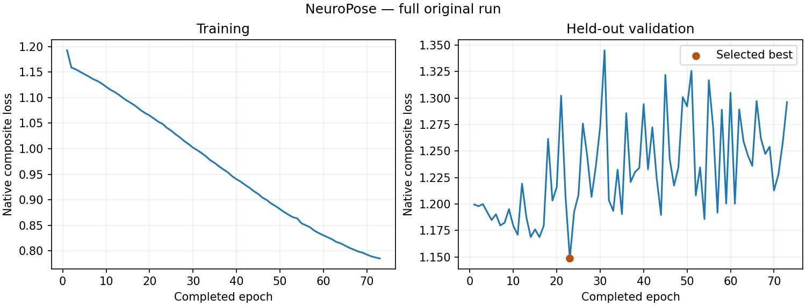

# NeuroPose 原生配方完整旧版实验

本实验已完成训练、验证选优、冻结测试、独立进程精确复算和公开报告验收；整篇论文仍未完成。

| 统计范围 | Gesture | User | Both | 加权总体 |
| --- | ---: | ---: | ---: | ---: |
| 完整轨迹 MAE (°) | 16.157693 | 16.543476 | 16.821668 | 16.358404 |
| 中心 MAE (°) | 16.305841 | 16.457084 | 16.927829 | 16.411552 |

真实训练73轮，原上限100轮、patience50；验证最优是第23轮（原epoch索引22），val_loss=1.1485108为复合损失，不能当作角度误差。29,054次尝试中实际29,043次更新，11次自然FP16溢出跳步。训练101,714/验证1,576/测试4,306个手样本，原22角、7,790点轨迹及中心3895保留。

单CUDA rank、全局batch256、16-mixed；GPU训练11.29小时，完整九阶段12.22小时。原生与独立验证/测试的预测、输入、目标、掩码、样本和元数据摘要精确一致，另进程从原始证据重新生成报告和曲线一致，20个记录的拥有进程均已退出。实际检查点与源身份见[完成证据](../../neuropose-native-full-completion-20261029.json)。

训练持续改善、验证在第23轮后无新最优，因此按原规则早停并使用验证最优。完整曲线与原始逐轮数据均保留。

[统计报告](metrics.md) · [完整匿名统计与配置](metrics.json) · [逐轮曲线数据](curve-data.json) · [SVG曲线](training-curves.svg) · [文件完成校验](completion.json)

当前公开旧版人口、生成标签与过滤依赖未证明等价于PDF原表；单rank/全局batch256也与原声明六rank的BatchNorm统计不同。本实验不证明随机训练续跑轨迹等价，也不能直接与不同窗口/人口/损失协议的模型作受控排名。
