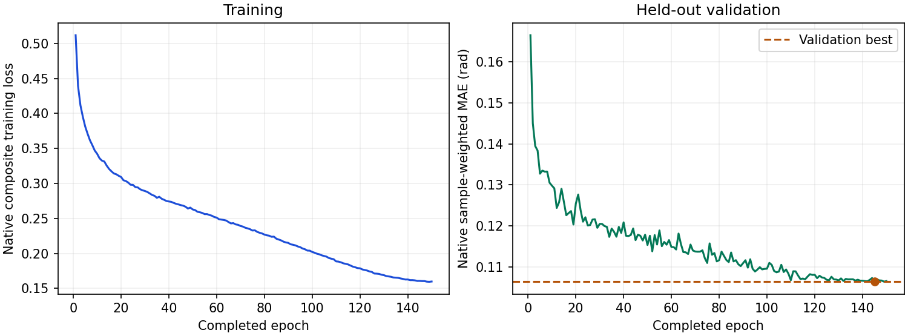

# ResNet-18＋EMGFormer-S：原生配方完整结果

150轮、46,950次更新和完整验证／测试／独立新进程重放均已结束。验证选中第145轮，测试前冻结验证规则。独立退出后读取器重开53份完整来源（61,377,230,438bytes）、原始检查点、typed预测、原生报告及曲线，模型／优化器构造和新增前向／更新均为0。50个原失败／恢复／准入拥有者及4个独立收集拥有者均已关闭，另一个标准库接收者也已退出。见[完整验收](../../native-rn18-fusion-full-complete-20261102.json)。

| 指标 | 实际结果 |
| --- | ---: |
| 含回归头完整参数量 | 15,452,413 |
| 全部唯一中心 pooled MAE | **6.1890975393°** |
| 有图子集 pooled MAE | **6.0797777057°** |
| 原生batch样本加权 MAE | 6.1846948854° |
| 正式训练／更新 | 150轮／46,950 |
| 验证选优 | 第145轮（原索引144） |
| train／val／test | 62,470／1,052／2,792 |
| 测试消费／唯一手请求 | 2,792／2,792，repeat1 |
| 有效中心／完整无效请求保留 | 2,708／84 |
| 有图／缺图请求保留 | 2,688／104 |
| 全部／有图有效角度数 | 59,576／59,136 |

总体pooled按有效角度累计，不直接平均split均值；原生样本加权batch值另列。原generated mask、缺图和全部无效请求均保留，未增加腕角过滤。用户别名只在公开聚合时生成。

## 论文Table3参照

论文RN18＋S Avg为5.4°，本次全部中心为6.189098°，描述性数值差约+0.79°。原表只保留一位小数；当前旧版／单rank／独立train内验证的人口、来源、mask与聚合没有证明与作者等价，差值不归因于单一因素。

| 条件 | 本次跨用户mean±SD（°） | 有效用户键数 |
| --- | ---: | ---: |
| gesture | 5.819430±1.424904 | 36 |
| user | 6.669391±0.438732 | 5 |
| both | 6.738172±0.494162 | 5 |

条件统计是逐用户键等权均值和总体SD（ddof=0），不是自然人身份已独立核实。User／Both标签各仍与train共享1个元数据用户键，按原始人口说明保留。

## 训练来源与官方代码优先

固定官方`f7cbd048b7092139852270491d3859cd472e0311`的`fusion/fusion_rn18_s_center_8ch`，保留MidFusionPoseFormer、目标手8通道、12,000窗口、训练stride1,200／评价12,000、repeat1、RGB原变换及22角中心监督。全部角色实际batch200／10workers、BF16、clip1；Adam lr6e-4／WD1e-4、cosine150／eta1e-5，每轮完整验证、top3＋last、无EarlyStopping。两个指尖别名实际累计为0.02；执行配置不冻结视觉分支／BN，按可执行字段处理与注释的歧义。

原统计资产中声明的egoemg_unified命名查找失败，明确使用同一原资产的egoemg每手／每通道float32向量；filtered_paper仅是实际filtered字段的IO别名。没有改写原数据、标签或统计，也没有声称来自本次train估计。

视觉初始化来自实际完整训练的历史RN18 LAST，保留其legacy0.01／无jitter／train-only归一化来源差异；兼容cotrain-S的完整150轮验证BEST经独立完整读取后交接。旧先验分支、完整命名张量及未来val／test输入零重叠均核验，未把BEST换成LAST或用未训练模型替代。来源descriptor和policy各自的未完成标志保留原字节；本实验完成资格由最终训练、冻结评价与退出后链证明。

## 显式恢复与执行边界

资格先完成原batch200／10workers的两轮、共4次工程更新及完整评价；正式150轮从独立新模型开始，不复用资格权重。正式69轮／21,597更新时因外来GPU上下文到达保护停止，原失败记录和四份检查点归档保留。六类model／optimizer／scheduler／callbacks／loops／RNG的恢复逐项精确，接续原150轮／46,950总预算，未重复初始化或已成功资格。持久worker等状态不保证无中断逐批bitwise同轨迹。

最近一次fit调用elapsed为7431.651033秒；退出后独立读取耗时172.094517秒。它们不等于从第0轮累计的总训练时长或论文GPU-hours。声明4设备而实际单rank／单张指定A800的适配、旧版41段、未获得作者混合来源继续披露。

旧[legacy RN18＋S结果](../../completed/fusion-rn18-s/metrics.json)6.793533°原样保留。本结果与原生视觉4,306人口和新同帧4,282人口不同，不能把这些数值直接拼成控制变量融合收益。此次补齐同一模型条目的原生协议，不增加14模型家族数量。

[原始指标JSON](metrics.json) · [原始完整报告](metrics.md) · [完成标记](completion.json) · [原始曲线数据](curve-data.json) · [150轮CSV](training-history.csv) · [原始SVG](training-curves.svg) · [原实验／恢复说明](../../../docs/native-rn18-fusion.md)

原始六个报告产物均与服务器逐字节一致；上图已目视检查，无重新绘图或修改指标。全文、当前数据人口／标签版本等价、新同帧Table10、密网格遮挡／增益以及标注等剩余目标仍待完成。
