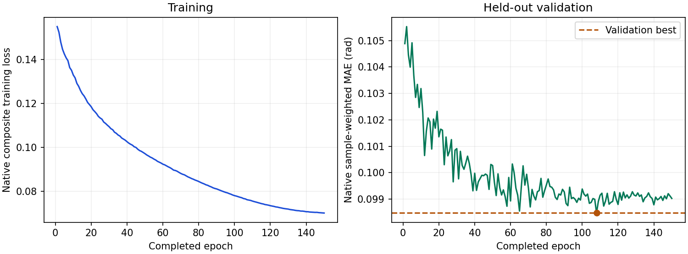

# ViT-S + EMGFormer-S：旧版队列上的完整原生结果

完成原定 150 轮训练、独立验证选best、完整原生测试、新进程完整重放、报告和另进程核验。最终报告的 scientific_eligible=true，full_paper_complete=false。

| 指标 | 结果 |
|---|---:|
| 全部唯一手样本中心 pooled MAE | 6.342238° |
| 有图子集中心 pooled MAE | 6.205656° |
| 测试消费 / 唯一手样本 | 8,612 / 4,306 |
| 唯一全部 / 有图有效角度 | 91,916 / 90,926 |
| 完整轮次 / 实际更新 | 150 / 296,550 |
| 验证选中轮次 | 第 108 轮（原索引 107） |
| 原生验证选优值 | 0.098471939564 rad |
| 原生样本加权 test_mae | 0.110610395670 rad |

总体指标为第一遍唯一手样本的 float64 有效角度加权 MAE。原repeat2的8,612次消费不是8,612个独立样本；消费人口和唯一人口、全部样本和有图子集在原始报告中分别保留。原生样本加权弧度指标与 pooled 度数指标分别报告。

固定官方融合合成实验 fusion/fusion_vits_s_center_16ch_wl7790：目标手8通道放入原16槽，其余补零，7,790点、stride400，原repeat2；batch200、BF16、单 rank/workers0。保留原生联合训练、0.02有效指尖项、AdamW与150轮余弦调度，不早停。

原生分支交接使用实际完成124轮的ViT-S last，以及完成150轮的兼容EMG初始化分支验证best（原索引133）；初始化分支不另计为论文完成设置。从真实32轮/63,264更新状态显式恢复，新增233,286次更新，最终150轮/296,550次更新。六域按原生可恢复契约核验，恢复前完整验证一致。原生训练曲线保留原字节，恢复边界32轮在本说明和来源清单中记录。

不保证与不中断训练逐位同轨迹。生产者记录的 `elapsed_fit_seconds`=194648.982015 秒是续训段计时，不能当作含原前缀、等待和中断的完整历史总时长，也不能与论文GPU工时直接比较。

选中检查点：`vits-s-16ch-wl7790-epoch=107-val_mae=0.0985.ckpt`，原始文件 SHA-256 为 `a3ade1c4b6ba4615ebe51eb60523872a3d114f09e591c289c731d3754c439a99`。已在服务器实际逐字节hash核对；读取前后九项文件属性不变。最终模型按验证选择，未用测试改选权重。

ModelCheckpoint.current_score 属于原生 Lightning 不恢复的瞬态字段；回调恢复按公开原生契约核对。原全局loader RNG在迭代器重建后可能与不中断轨迹不同。

验证集两次完整消费各3,152手样本、测试集两次各8,612手样本，分别使用实际不同进程，typed预测/目标/mask/输入摘要精确一致；验证策略在测试之前冻结。8个评估阶段均退出0，原训练/评价拥有进程的22个唯一身份均已确认关闭。

论文Table3的Avg为5.5°，本次全部中心为6.342238°，描述性数值差约+0.84°。当前是可下载旧版数据、独立train留出验证、单rank的结果；数据版本、标签/人口、掩码、聚合、缺失作者独立配方及六rank等价性未闭合，不能称为同条件数值复现或多seed架构结论。

历史policy/identity/fit与阶段包装器中的未完成标志原样保留；它们不是完整评价完成证书。最终结果资格由完整训练、冻结验证、原生测试、独立重放与报告链共同验收。附带原生距离/导数输出不据此宣告论文其他距离或时序实验已复现。

原始六个生产者文件保持逐字节一致，包含原始SVG；没有重新绘图或修改MAE。来源清单区分文件字节SHA、JSON payload seal与typed模型/预测SHA。

[原始报告](metrics.md) · [机器可读指标](metrics.json) · [完成标记](completion.json) · [150轮原始曲线数据](curve-data.json) · [原始SVG](training-curves.svg) · [公开来源与实际验收](publication-manifest.json) · [执行说明](../../../docs/fusion-native-training.md)

