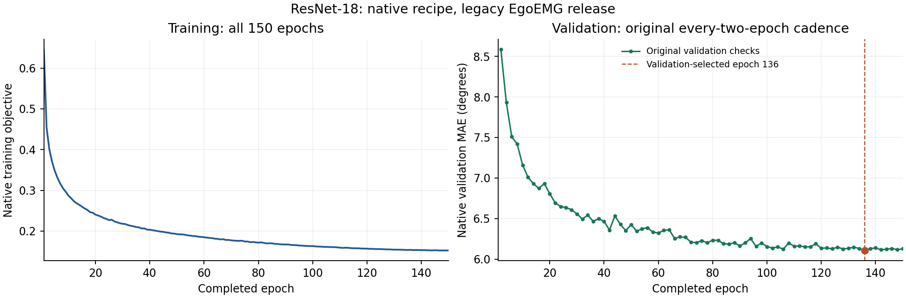

# ResNet-18 原生配方完整训练与中心评价

原生150轮、完整验证/测试及不同进程精确重放已结束，原19阶段及40个显式拥有进程均已关闭。额外独立收集进程重读原始预测、检查点与全部52个注册来源文件（57,145,308,966bytes），零模型/优化器构造、零新推理/更新；其4个拥有进程也已关闭。原始[JSON](metrics.json)、[Markdown](metrics.md)、[完成清单](completion.json)从服务器逐字节取得，见[完整验收证据](../../native-rn18-full-complete-20261102.json)。

| 项目 | 实际结果 |
| --- | ---: |
| 完整参数量 | 11,450,454 |
| 正式训练 | 150轮／33,750次更新 |
| 验证选优 | 第136轮（零起算135） |
| train / val / test 消费 | 202,020 / 3,152 / 8,612 |
| 测试唯一手样本／其中有效标签 | 4,306 / 4,178 |
| 唯一首遍中心pooled MAE | **6.6071950723°** |
| 唯一有图子集pooled MAE | **6.4699793503°** |
| 全部8,612消费pooled MAE | 6.6071959854° |
| 原生batch样本加权MAE | 6.6052240831° |
| 唯一首遍有效角度数 | 91,916 |

上述分母和聚合方式分别保留。有图子集4,133点；173个缺图请求与128个全角无效请求仍留在原4,306点队列中，没有删掉缺图或无效请求来改变报告人口。唯一首遍和全部消费相差不足0.000001°，并非强制复制同一数值。

## 与论文Table3的数值参照

论文RN18 Avg为5.9°；本次唯一首遍pooled为6.607195°，数值高约0.71°。原表只显示一位小数；数据与聚合并非已证明同条件，不能把差值单独归因为实现。

| 条件 | 论文跨用户mean±SD | 本次跨用户mean±SD（ddof=0） | 本次用户键数 |
| --- | --- | --- | ---: |
| gesture | 5.1±1.3° | 6.190001±1.349250° | 36 |
| user | 6.8±1.7° | 8.073252±2.251468° | 6 |
| both | 6.8±0.9° | 6.981190±0.622379° | 5 |

条件mean±SD是跨用户键的无权平均和总体标准差；总体pooled按有效角度累计，不能由三个条件均值直接算出。用户键不是独立确认的自然人身份。

## 原生执行与适用边界

固定官方版本`f7cbd048b7092139852270491d3859cd472e0311`，实际执行源码`19526d3da4718fe957d478eea8ec9a013992ad02`。保留原ResNetVisionPose、真实ImageNet初始化、256crop、22维中心监督、7,790点窗口、stride780／7,790、repeat2、batch900、8workers、BF16、AdamW1e-4／WD0.01、cosine150／eta1e-5、clip1、有效指尖系数0.02；每两轮验证、top3+last、原patience30按真实验证次数计数。正式150轮从独立新模型开始，资格的4轮／8次更新未当作正式模型。

原fit elapsed为24392.007716秒（6.775558小时），单张A800，包含原训练器的数据读取、验证与保存等开销，不声称等于论文GPU-hours。

采用41段可得旧发布、独立训练内时间验证、单rank和seed42；作者声明六设备、合并训练来源及当前完整发布没有全部复现。真实User/Both标签各仍与train共享1个元数据用户键，不能据名称宣布严格未见用户泛化。原生独立验证与训练时保存验证的差异在原始报告中保留；测试前冻结选模与评价规则，未用测试调参。

历史[legacy RN18](../../completed/resnet18/metrics.json)的12,000点／0.01配方与7.784887°结果原样保留；本次不同窗口、损失、loader与测试人口，不作控制变量改进归因。其与legacy融合的旧匹配收益也不能换用本次新基线计算。

[全部150轮CSV](training-history.csv) · [SVG](learning-curves.svg) · [绘图来源与哈希](learning-curves.json) · [可直接复画的脚本](../../../scripts/paper/render_native_rn18_history.py)

在已有绘图环境运行 `python scripts/paper/render_native_rn18_history.py` 即可重建。实际从其他工作目录两次执行该公开脚本，输出逐字节一致；PNG保留首遍原字节，SVG仅规范化Matplotlib行尾空白；它会先核对原始报告与150轮CSV的哈希，不读取模型或训练数据。

这补齐同一RN18架构的原生协议结果，不新增模型家族。原生RN50/152、RN18融合、S/M/L轨迹、EMG2Pose基准、标注与完整数据等仍有剩余工作，整篇论文尚未完成。
