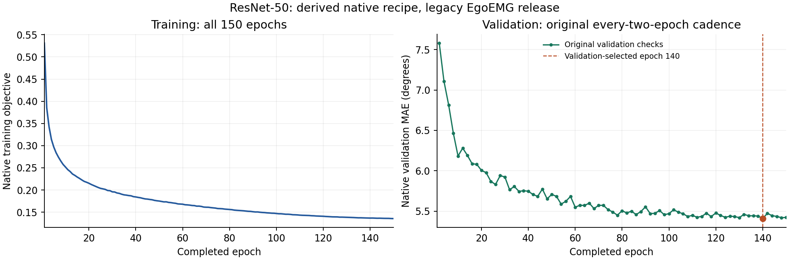

# ResNet-50：明确派生的原生配方完整结果

150轮正式训练、完整验证／测试及独立typed重放／报告均已结束。当前共享资源接续的9阶段／20个拥有者关闭；原10阶段资格的20个消费者结果SHA也已复核，未重复资格训练。额外退出后读取器重开原预测／检查点／完整52来源57,145,308,966bytes，零模型或优化器构造、零新推理或更新；其4个拥有者均关闭。见[完整验收](../../native-resnet50-full-complete-20261102.json)、原始[JSON](metrics.json)、[Markdown](metrics.md)及[完成清单](completion.json)。

| 项目 | 实际结果 |
| --- | ---: |
| 含回归头完整参数量 | 24,568,406 |
| 正式训练 | 150轮／75,900次更新 |
| 验证选优 | 第140轮（零起算139） |
| train／val／test 消费 | 202,020／3,152／8,612 |
| 测试唯一手请求／至少一角有效 | 4,306／4,178 |
| 唯一首遍中心pooled MAE | **5.8809983837°** |
| 唯一有图子集pooled MAE | **5.7398177692°** |
| 全部8,612消费pooled MAE | 5.8809980766° |
| 原生batch样本加权MAE | 5.8769880331° |
| 唯一首遍有效角度数 | 91,916 |

有图子集4,133点；173个缺图及128个全角无效请求保留在完整4,306点队列中。分母和聚合分别保留，未通过删除缺图／无效请求改变人口。

## 与论文Table3的数值参照

论文V-RN50 Avg为5.3°；本次唯一首遍pooled为5.880998°，数值高约0.58°。原表仅一位小数；PDF Avg为跨split样本加权，本次为有效角度pooled，数据与执行条件也未完全对齐，不能将差值归因为单一实现因素。

| 条件 | 论文跨用户mean±SD | 本次跨用户mean±SD（ddof=0） | 本次用户键数 |
| --- | --- | --- | ---: |
| gesture | 4.5±1.3° | 5.416069±1.375946° | 36 |
| user | 6.2±2.2° | 7.255039±1.909493° | 6 |
| both | 6.2±0.7° | 6.370522±0.690155° | 5 |

条件mean±SD按用户键无权平均／总体标准差计算；总体pooled按有效角度累计，不能直接平均三个条件均值。用户键不代表独立确认的自然人身份。

## 来源、恢复和适用边界

固定官方版本`f7cbd048b7092139852270491d3859cd472e0311`；该版本没有独立RN50 YAML。本配方明确由RN18配置覆盖ResNet-50 backbone和论文Table8的batch400得到，采用原ResNetVisionPose、真实本地ImageNet资产、256crop、22维中心监督、7,790窗口、stride780／7,790、repeat2、8workers、BF16、AdamW1e-4／WD0.01、cosine150／eta1e-5、clip1、有效指尖系数0.02、每两轮验证及原patience30／top3+last回调。不是声称发现了作者缺失的独立配方文件。

检查点文件名`resnet18-vision-epoch=139-val_mae=0.0944.ckpt`继承原YAML的文件名前缀；真实backbone、完整24,568,406参数状态及其来源按ResNet-50核验，未根据文件名推断模型。原始文件名和SHA保持。

正式fit从独立新模型开始，随后因资源中断保留原检查点并明确接续。六类model／optimizer／scheduler／callbacks／loops／RNG恢复均已逐项校验；原失败记录和归档保留。持久worker增强状态等不保证与无中断逐批轨迹bitwise等价。共享指定A800时采用≥64GiB稳定20秒准入、运行保留>8GiB，并记录其它上下文；未修改或终止其它账号进程。

75,900是最终已保存检查点／完整epoch日志链的global step，不包含中断后丢弃的额外计算步骤；不能据此反推所有历史尝试的总计算量。

最近一次fit调用elapsed为23249.071367秒；最近一次接续完整流程elapsed为24026.245439秒，包含等待／读取／验证／保存等。它们不是从第0轮起累计的总训练工时，也不等于论文独占六卡GPU-hours。

当前是41段可得旧发布、独立train内时间验证、单rank及seed42。User／Both标签各与train共享1个元数据用户键；合并训练来源、当前完整数据、严格未见用户人口和作者六rank执行尚未证明等价。原生独立验证与训练时保存验证的差异按原始报告保留，选模和评价规则先于测试冻结。

历史[legacy RN50](../../completed/resnet50/metrics.json)的12,000点／0.01配方及6.640058°结果保留。不同窗口、损失、归一化与测试人口之间的数值变化不作控制变量改进归因。

[150轮CSV](training-history.csv) · [SVG](learning-curves.svg) · [绘图来源与SHA](learning-curves.json)

此结果补齐同一RN50架构的原生派生协议；模型家族数量不增加。RN152、RN18融合、原生S／M／L轨迹、EMG2Pose完整基准、标注／来源及全文其它项目仍待完成。
