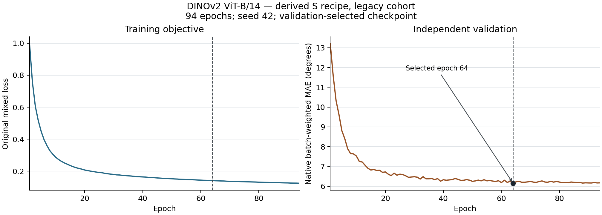

# DINOv2 ViT-B/14：S配方显式派生、旧版队列完整实验

2026-10-28完成独立核验。完整训练、验证选模、原生最终测试、新进程完整预测复算、报告和最后核验共16个服务器阶段实际exit0；控制器与全部阶段进程实际PID/start确认退出。另用同一冻结环境重新打开原始链条核验通过，未初始化CUDA。这里只完成该模型设置，整篇论文仍未完成。

| 指标 | 中心MAE (°) | 有效角度数 |
| --- | ---: | ---: |
| 全部测试、唯一首遍 | 6.761261 | 91,916 |
| 有图子集、唯一首遍 | 6.623680 | 90,926 |

原配置三个角色都repeat2，测试共8,612次手样本消费、4,306个唯一手样本；全部消费MAE仍为6.761261°，有效角度分母为183,832。重复消费不作为独立样本。原生样本加权的批量test MAE为0.11792339384555817 rad，和有效角度加权pooled MAE分列。

| 旧发布条件 | pooled MAE (°) | 逐用户 mean ± SD (°) | 用户数 |
| --- | ---: | ---: | ---: |
| Gesture | 6.193763 | 6.252778 ± 1.384177 | 36 |
| User | 7.418587 | 8.931966 ± 3.216250 | 6 |
| Both | 7.378649 | 7.365534 ± 0.344988 | 5 |

总体逐用户无权均值为6.662327° ± 1.991625°，41个metadata subject；SD为总体标准差ddof=0。条件用户集合并不互斥，人数不能相加。User/Both各有1个subject键与训练相交，条件名不能证明严格未见用户。

训练完成94轮、52,828次实际更新；原150轮上限、patience30早停。实际验证选择零起算epoch63（第64轮），分数0.107392817735672 rad，检查点SHA256为`77b5a83c7c279568be7c4a7c2bbf304d95c4672aee2e827f106418022c0a3a4b`。文件名`vit-small-epoch=063-val_mae=0.1074.ckpt`沿用S配方模板，实际骨干与86,182,166个参数已经按原构造/权重来源和schema核对为ViT-B。未用最后一轮代替验证选模。

作者未发布独立B YAML。本实验明确从固定官方S配方切换为真实DINOv2 ViT-B/14，记录为`explicit_small_recipe_derivation`。保留实际原AdamW基础LR0.0001、weight decay0.01、cosine150/eta_min0.00001、clip1、各角色batch360、bf16-mixed、有效0.02指尖项及原生成标签mask；窗口7,790点、train/eval stride780/7,790。单rank/workers0、seed42、独立train留出验证；合并训练来源未补齐，旧版数据/标签与PDF、六rank等价性未证明。该协议与七项12,000点/0.01 legacy结果不同。

固定上游f7cbd048b7092139852270491d3859cd472e0311，实际冻结复现代码[`e7c20b9`](https://github.com/ZSHYC/EgoEMG-Reproduction/tree/e7c20b9916efbdc7ecb4ce1385d311692a17e0bd)，12个相关源文件逐一核对Git内容摘要。运行时Python3.11.12、Torch2.2.2+cu118、torchvision0.17.2+cu118、Lightning2.5.0.post0、timm1.0.15。完整训练墙钟76,460.655秒（约21.24小时），为共享单A800时间，不能当作论文GPU-hours。

服务器三个核心报告保持原字节；[执行合成配置](execution-contract.json)和[补充发布清单](publication-manifest.json)记录配方来源、实际消费、源码/依赖、原生循环及94轮哈希链曲线。当前seed42、相同旧队列和声明配方下，ViT-S为6.464179°、本ViT-B为6.761261°；这不是多seed的架构优劣结论或PDF数值等价声明。

- [完整JSON指标](metrics.json) · [完整可读报告](metrics.md) · [原完成标记](completion.json)
- [训练/验证曲线数据](curve-data.json) · [PNG](training-curves.png) · [SVG](training-curves.svg)

