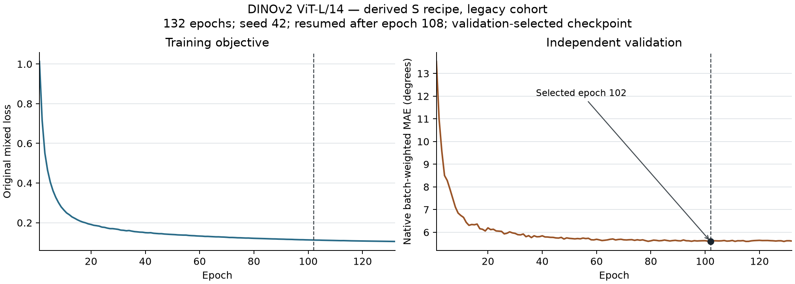

# DINOv2 ViT-L/14：显式派生配方、激活重计算与原生续训的旧版队列完整实验

2026-10-30 完成完整训练、验证选模、原生最终测试、独立进程完整重放、报告生成及最终复核。此次续训与评估的 9 个阶段均实际退出 0，原控制器和所有阶段进程已按 PID/start 确认退出。这里只验收该模型设置，整篇论文复现仍在进行。

| 指标 | 中心 MAE (°) | 有效角度数 |
| --- | ---: | ---: |
| 全部测试、唯一首遍 | 6.229674 | 91,916 |
| 有图子集、唯一首遍 | 6.087737 | 90,926 |

测试共 8,612 次手样本消费、4,306 个唯一手样本；原配置 repeat2，重复消费不计为额外独立样本。全部消费 pooled MAE 为 6.229674°、有效角度分母 183,832。原生样本数加权批量 test MAE 为 0.10864157229661942 rad，与有效角度加权 pooled MAE 分列。

| 旧发布条件 | pooled MAE (°) | 逐用户 mean ± SD (°) | 用户数 |
| --- | ---: | ---: | ---: |
| Gesture | 5.632757 | 5.685310 ± 1.385088 | 36 |
| User | 6.922241 | 8.018435 ± 2.327142 | 6 |
| Both | 6.872983 | 6.851098 ± 0.480964 | 5 |

总体逐用户无权均值为 6.044113° ± 1.745074°，共 41 个 metadata subject；SD 使用 ddof=0。条件用户集合并不互斥，User/Both 各有一个 subject 键与训练相交，条件名不能证明严格未见用户泛化。

## 训练、选模与续训来源

完整训练完成 **132 轮、74,184 次更新**。原上限 150 轮、patience30 早停规则保留；实际选优为零起算 epoch101（第 102 轮），验证分数 0.097628556191921234 rad。原选优检查点 SHA256 为 `7969b255c30ed1ea0dea2c7ec2bfcc5e3b981e75bfc29e10c4e0d524cad2c7df`。文件名 `vit-small-epoch=101-val_mae=0.0976.ckpt` 沿用 S 配方模板；实际骨干为 DINOv2 ViT-L/14，总参数 **303,833,622**，342 个预训练张量已按原身份核对。

此前在完成 108 轮后因共享磁盘资源门槛中断，旧失败状态和父检查点保留。此次从真实 108 轮/60,696 次更新的原生检查点续训，模型、优化器、调度器、回调、循环及 RNG 六域恢复均通过检查；续训前后原配置未改。原生迭代器重入可能改变后续全局 RNG 消费，未宣称与从不中断训练的逐位轨迹相同。
记录的 64815.267 秒 fit 墙钟属于第 109–132 轮续训段；132 轮总墙钟未在此汇总。共享单 A800 的运行时间不用于论文 GPU-hours 对照。

作者没有发布独立 L YAML。本实验从固定官方 S 配方切换真实 ViT-L/14，并显式启用 timm 原生激活重计算；[原360/bf16资格证据](../../vision-literal-large-checkpoint-gpu-engineering.json)保留此前未启用版本的显存失败。实际模型、损失和优化器配方保留；单 rank/workers0、seed42、batch360、bf16-mixed、AdamW 基础 LR0.0001/weight decay0.01、cosine150/eta_min0.00001、clip1，有效指尖项0.02及原生成标签 mask。窗口7,790点，train/eval stride780/7,790。

固定上游 f7cbd048b7092139852270491d3859cd472e0311，实际冻结复现代码 [`2129acc`](https://github.com/ZSHYC/EgoEMG-Reproduction/tree/2129acccff74e0553fc574375effbc95bcb50271)；12 个相关源文件与 Git 对象逐一匹配。运行来源、实际恢复与阶段退出记录见[发布清单](publication-manifest.json)，配方声明和实际训练策略分别见[合成配置](execution-contract.json)与原始指标的 training.execution_policy。

## 与论文的数值参照

论文 Table3 的 ViT-L Avg 为 5.4°；本次全部中心为 6.229674°，数值高约 0.83°。旧版队列、独立 train 留出验证、数据/标签/掩码、聚合方式和单 rank 均须计入解释；未证明与 PDF 原表或多 seed 等价。该协议与既有七项12,000点/0.01 legacy 实验不同。完整数值对照见[汇总](../../paper-comparison/README.md)。

- [完整JSON指标](metrics.json) · [完整可读报告](metrics.md) · [原始完成标记](completion.json)
- [132轮曲线数据](curve-data.json) · [PNG](training-curves.png) · [SVG](training-curves.svg)

