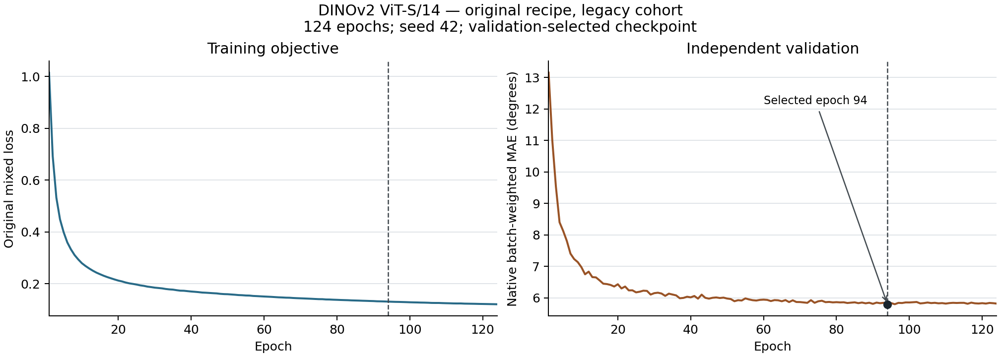

# DINOv2 ViT-S/14：原生配方、旧版队列完整实验

2026-10-28完成核验。完整训练、独立验证选模、原生最终测试、完整预测独立复算、报告发布及最后核验共16个服务器阶段实际exit0；外层控制器及阶段子进程已独立确认退出。另用同一冻结环境重新打开原始链条核验通过，没有重新训练或测试。整篇论文仍未完成。

| 指标 | 中心MAE (°) | 有效角度数 |
| --- | ---: | ---: |
| 全部测试、唯一首遍 | 6.464179 | 91,916 |
| 有图子集、唯一首遍 | 6.324737 | 90,926 |

按原配置测试重复2遍，共8,612次手样本消费、4,306个唯一手样本。完整消费MAE与唯一首遍均为6.464179°，但有效角度分母分别为183,832/91,916；不能把重复消费当作8,612个独立样本。原生按样本数加权的批量MAE为0.1127345860004425 rad，与有效角度加权的pooled MAE分列。

| 旧发布条件 | pooled MAE (°) | 逐用户 mean ± SD (°) | 用户数 |
| --- | ---: | ---: | ---: |
| Gesture | 5.868828 | 5.909170 ± 1.392644 | 36 |
| User | 7.128222 | 8.649699 ± 3.272834 | 6 |
| Both | 7.245134 | 7.229314 ± 0.528622 | 5 |

SD为逐用户均值的总体标准差（ddof=0），不等于样本加权pooled MAE。全部用户无权均值为6.332664° ± 2.023266°，共41个metadata subject。发布的User/Both各与训练有1个subject键交集，不能据条件名声称严格未见用户。

训练完成124轮、69,688次实际参数更新；上限150轮，原patience30早停。按完整独立验证选择零起算epoch93（第94轮）的`vit-small-epoch=093-val_mae=0.1012.ckpt`，原验证选择分数0.10121652483940125 rad，没有使用最后一轮替代。

保留实际原生配方：AdamW基础学习率0.0001、weight decay0.01、cosine150、梯度裁剪1、各角色batch360、bf16-mixed，原有效0.02指尖项及生成标签mask。输入窗口7,790点，train/eval stride780/7,790，三个角色都repeat2。使用单rank/workers0及独立train留出验证；作者声明的合并训练来源未补齐，旧版标签与PDF/当前全发布等价性未证明。这些结果不能直接与七项12,000点/0.01协议的legacy成绩作受控比较。

实际冻结复现代码为[`e7c20b9`](https://github.com/ZSHYC/EgoEMG-Reproduction/tree/e7c20b9916efbdc7ecb4ce1385d311692a17e0bd)，12个相关源文件逐一核对Git内容摘要；上游固定f7cbd048b7092139852270491d3859cd472e0311。运行时Python3.11.12、Torch2.2.2+cu118、torchvision0.17.2+cu118、pytorch-lightning2.5.0.post0、timm1.0.15。额外核验必须使用此冻结依赖环境；服务器基础环境中的Lightning2.5.1.post0会被源摘要校验拒绝，未放宽门槛。

[执行合成配置](execution-contract.json)保留原声明与实际消费差异，[补充发布清单](publication-manifest.json)绑定实际策略、软件源、124轮曲线及原服务器报告摘要。旧版原报告三个文件保持服务器原字节；新补充清单没有重写其科学结果。完整训练墙钟71,229.217秒（约19.79小时），为共享单A800运行时间，不作为论文GPU-hours。

- [完整JSON指标](metrics.json) · [完整可读报告](metrics.md) · [原完成标记](completion.json)
- [训练/验证曲线数据](curve-data.json) · [PNG](training-curves.png) · [SVG](training-curves.svg)

