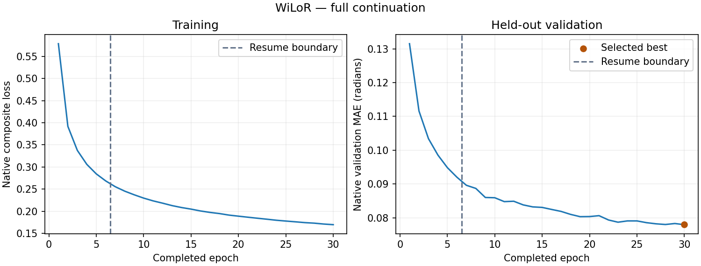

# WiLoR：旧版队列上的完整原生结果

完成原定 30 轮训练、独立验证选best、完整原生测试、新进程完整重放、报告和另进程核验。最终报告的 scientific_eligible=true，full_paper_complete=false。

| 指标 | 结果 |
|---|---:|
| 全部唯一手样本中心 pooled MAE | 5.107042° |
| 有图子集中心 pooled MAE | 4.952077° |
| 测试消费 / 唯一手样本 | 8,612 / 4,306 |
| 唯一全部 / 有图有效角度 | 91,916 / 90,926 |
| 完整轮次 / 实际更新 | 30 / 336,720 |
| 验证选中轮次 | 第 30 轮（原索引 29） |
| 原生验证选优值 | 0.077958375216 rad |
| 原生样本加权 test_mae | 0.089343406260 rad |

总体指标为第一遍唯一手样本的 float64 有效角度加权 MAE。原repeat2的8,612次消费不是8,612个独立样本；消费人口和唯一人口、全部样本和有图子集在原始报告中分别保留。原生样本加权弧度指标与 pooled 度数指标分别报告。

真实原生 WiLoR 22 角模型；batch18、BF16、单 rank/workers0，保留30轮预算、原损失与验证选模。原调度器初始学习率与 eta_min 同为1e-5，实际为常数学习率。

从真实6轮/67,344次更新状态显式恢复，续训执行269,376次更新，总计30轮/336,720次更新。原生可恢复的模型、优化器、调度器、回调、循环与RNG六域已核验；旧磁盘失败和原前缀记录保留。图中虚线标出6轮恢复边界。

不保证与不中断训练逐位同轨迹。生产者记录的 `seconds`=77713.042998 秒是续训段计时，不能当作含原前缀、等待和中断的完整历史总时长，也不能与论文GPU工时直接比较。

选中检查点：`vit-small-epoch=029-val_mae=0.0780.ckpt`，原始文件 SHA-256 为 `c62d2ef83975faf96c115e2a32a9a85b36cd44fcb688123c71b069cfb5b8e666`。已在服务器实际逐字节hash核对；读取前后九项文件属性不变。最终模型按验证选择，未用测试改选权重。

检查点的 vit-small 前缀沿用原脚本命名模板；实际模型身份为 WiLoR，由构造来源、模型状态和原始检查点哈希绑定。

验证集两次完整消费各3,152手样本、测试集两次各8,612手样本，分别使用实际不同进程，typed预测/目标/mask/输入摘要精确一致；验证策略在测试之前冻结。7个评估阶段均退出0，原训练/评价拥有进程的20个唯一身份均已确认关闭。

论文Table3的Avg为4.7°，本次全部中心为5.107042°，描述性数值差约+0.41°。当前是可下载旧版数据、独立train留出验证、单rank的结果；数据版本、标签/人口、掩码、聚合、缺失作者独立配方及六rank等价性未闭合，不能称为同条件数值复现或多seed架构结论。

历史policy/identity/fit与阶段包装器中的未完成标志原样保留；它们不是完整评价完成证书。最终结果资格由完整训练、冻结验证、原生测试、独立重放与报告链共同验收。附带原生距离/导数输出不据此宣告论文其他距离或时序实验已复现。

原始六个生产者文件保持逐字节一致，包含原始SVG；没有重新绘图或修改MAE。来源清单区分文件字节SHA、JSON payload seal与typed模型/预测SHA。

[原始报告](metrics.md) · [机器可读指标](metrics.json) · [完成标记](completion.json) · [30轮原始曲线数据](curve-data.json) · [原始SVG](training-curves.svg) · [公开来源与实际验收](publication-manifest.json) · [执行说明](../../../docs/wilor-recovery.md)

