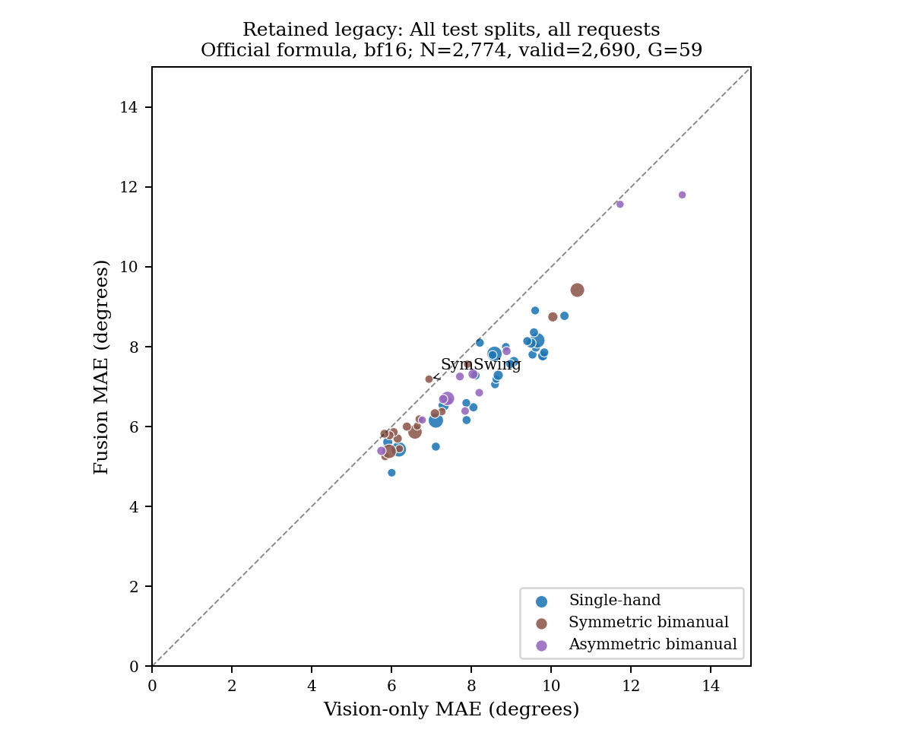
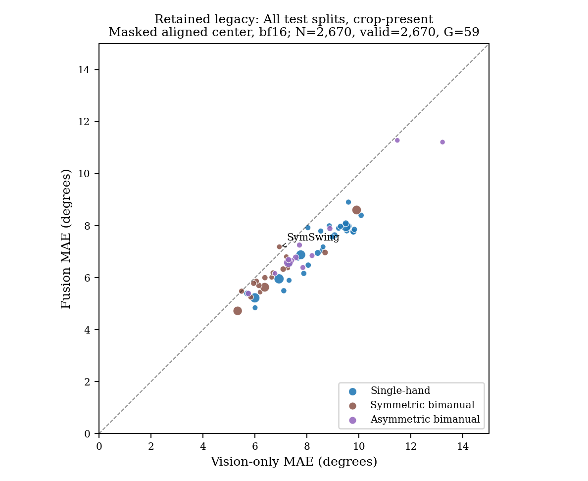
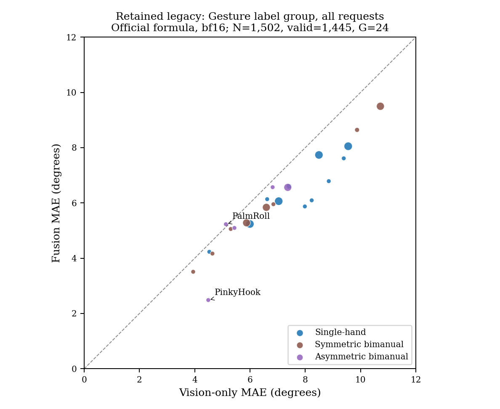

# 逐关节与逐手势分析：旧版完整实验的派生评价

2026-10-28完成五个冻结检查点的完整测试集推理及退出后独立复核。本目录支撑Table12/14/15和Figure12的方法与旧版实验分析；没有新增训练，也不代表PDF原表或当前官方0.02配方已复现。

原始S/M/L、RN18、RN18+S各2,792个手中心，全部中心指标均通过原1e-4度/计数精确相等门槛；三EMG完整轨迹还核对了整体、左右手、split、组件与逐用户原结果。七个实际受管理阶段139.31秒exit0，14个worker/guardian及外层拥有者独立确认退出，随后纯CPU/无Torch重读并独立核对所有类/族群/角度统计和三模型真值配对。

## 人口和统计口径

全部请求2,792，排除未分配动作18，raw50排除0，得到59类的2,774个请求；其中2,690个至少有一个有效角度，84个所有角度均无效。有图人口为2,688个请求，排除18个未分配后2,670个。它们不是PDF的4,278个手样本。

- `official_unmasked`按固定官方逐手势代码：Standalone EMG取原始token中点，视觉/融合取中心；22角均值不使用mask，随后等样本平均，转角度系数57.3。它在全部请求视图保留84个全角无效请求，只用于如实说明代码口径，不能当作有效监督精度。
- `masked_pooled`保留既有legacy协议：EMG按510上下文裁剪并插值后取输入中心，逐角mask有效性，按误差和/有效角数汇总，转角度系数180/pi。表中N_requested、N_valid和valid_angle_count各自保留。
- 五次推理保留原运行的bfloat16、matmul high，以及S/M/L各batch500、RN18 batch900、融合batch200，使既有baseline可以独立核对。官方公式视图复用取点、无mask、均值和57.3规则，精度仍为本次冻结legacy推理；未运行原脚本默认FP32的完整评价流程。
- 四个预先定义视图为all_test/gesture_only乘以all_requested/crop_present；activity只记录与配对，不额外过滤。Gesture标签组实际覆盖24类；名称不能证明等同论文的10类heldout定义。
- 所有表从未舍入底表生成；59类定义行保留，零覆盖的MAE为null/CSV空白。族群按固定非连续ID集合。官方公式的族群加权另与原`compute_family_stats`核对，差异低于1e-10度。

## Table14/15与Figure12

| 视图 | 公式 | 参与统计请求 | 至少一角有效 | 覆盖类 | 融合改善类 | Vision | EMG | Fusion |
| --- | --- | ---: | ---: | ---: | ---: | ---: | ---: | ---: |
| all_test/all_requested | official_unmasked | 2774 | 2690 | 59 | 58 | 7.951719 | 16.348602 | 6.999208 |
| all_test/all_requested | masked_pooled | 2774 | 2690 | 59 | 58 | 7.778114 | 16.333354 | 6.793020 |
| all_test/crop_present | official_unmasked | 2670 | 2670 | 59 | 58 | 7.683604 | 16.367291 | 6.691583 |
| all_test/crop_present | masked_pooled | 2670 | 2670 | 59 | 58 | 7.683328 | 16.296018 | 6.691150 |
| gesture_only/all_requested | official_unmasked | 1502 | 1445 | 24 | 23 | 7.683241 | 16.228560 | 6.731471 |
| gesture_only/all_requested | masked_pooled | 1502 | 1445 | 24 | 23 | 7.453577 | 16.227583 | 6.460537 |
| gesture_only/crop_present | official_unmasked | 1429 | 1429 | 24 | 23 | 7.283325 | 16.222416 | 6.280066 |
| gesture_only/crop_present | masked_pooled | 1429 | 1429 | 24 | 23 | 7.283280 | 16.148715 | 6.279661 |

在本次已声明旧版队列、seed42与原验证选模下，全测试59类中58类融合误差低于RN18；这是本项目实测，不能替代论文54/59或证明多seed稳定性。全测试mask口径的MAE为Vision 7.778114° / EMG 16.333354° / Fusion 6.793020°。

逐类CSV遵循官方族群顺序，并在每族内按未舍入Vision−Fusion降序排列，空类置后；族群CSV、原始JSON和相同数据的PNG/SVG同时保存。原脚本生成的LaTeX片段只用于官方公式，宏与表格环境需由论文工程提供。

## 原始绘图行为与补图

名为`figure12-*`的原生参考PNG/SVG由固定官方`generate_scatter`原样输出的PDF经Poppler转换；PDF仅作为私有中间文件。原生参考保留2.5度坐标下界和固定偏移的Top4标注；后者在全测试视图会出现原脚本自身的文字重叠。清晰展示使用`full-range-*`，保留相同数据、族群色及sqrt(N)截断到18–130的点面积，从0度显示全部点，标出退化类和原范围外的点，Top4名字可查未舍入CSV。Gesture-only的PinkyHook落在原下界外，清晰图完整显示。原脚本的负收益标注循环在首个非负收益处break，清晰图与表格仍完整列出退化类。原始脚本与原生参考均未修改。

## Table12：三个EMG完整轨迹的逐组误差

| 组 | S | M | L |
| --- | ---: | ---: | ---: |
| proximal | 15.510414 | 15.616024 | 15.865749 |
| mid | 24.059802 | 24.533609 | 24.423844 |
| distal | 10.672513 | 10.823971 | 10.800735 |
| thumb | 13.592681 | 13.675812 | 13.811690 |
| index | 14.595203 | 14.741223 | 15.062749 |
| middle | 17.775133 | 17.936064 | 18.112619 |
| ring | 17.285097 | 17.597835 | 17.403156 |
| pinky | 18.943313 | 19.286103 | 19.304882 |
| wrist_FE | 17.740158 | 17.690767 | 18.383150 |
| wrist_RU | 11.859114 | 12.053357 | 11.838805 |

单位为度。对应CSV/JSON同时给出每组弧度误差和、有效角时间计数及22个独立角统计；proximal/mid/distal与五指分组有重叠，不能相加。这里按legacy有效角时间pooled统计，不冒称原表分组Avg或跨用户SD已经等价。

## 来源与限制

固定官方f7cbd048b7092139852270491d3859cd472e0311。历史训练代码以Git7b805d4中的train/visual精确字节隔离加载；首次包因使用后来扩展DINO的当前文件而被严格预检拒绝，尚未进入GPU。失败和全部记录保留，旧检查点/数据/来源校验未改写或放宽。实际重新打包后五次推理完成；读取器一次本地路径拼接失败只重做只读读取，没有重复GPU工作。

仍使用旧版数据、0.01旧训练目标与训练区间标准化；User/Both标签与训练有用户键交集，当前unified来源、0.02新训练、严格PDF标签版本均未因此补齐。独立原始标注、其他模型、遮挡/定性图与全文其余项继续保持未完成。

- [全部实际来源、指标与完成证据](source-analysis.json) · [四视图摘要](view-summary.json) · [逐手势全部统计](gesture-tables.json) · [逐角/关节组](joint-groups.json)
- [Table12 CSV](table12-legacy-pooled-joint-groups.csv) · [官方公式Table14](table14-official_unmasked-all_test-all_requested.csv) · [官方公式Table15](table15-official_unmasked-all_test-all_requested.csv)
- [生产者与产物摘要](producer-manifest.json)；原始逐样本记录和身份映射保持私有。
