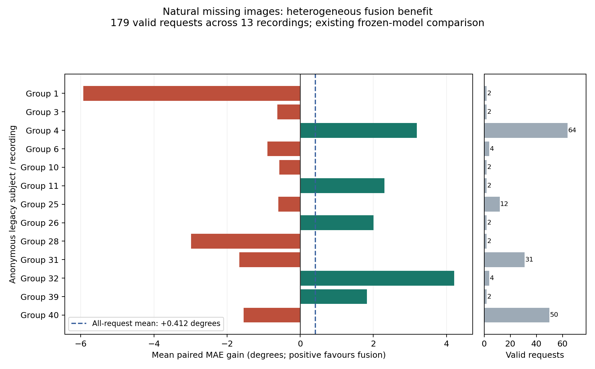

# 视觉缺失时，EMG 是否有用？

2026-11-03 用户要求在全文复现中重点验证这一问题。这里分析已完成的 ViT-S、EMGFormer-S 与融合的同帧预测，不新增训练、不改原图表或选模。**目前有小幅平均收益，尚未证明能稳定补偿视觉缺失，也未完成隔离 EMG 贡献的受控消融。**

受控评价的输入／真实模型接口已完成[45项服务器检查，0跳过](input-and-native-control-engineering-20261103.json)：两条实际冻结路线、左右手、各六条件共24个单请求接口调用，对齐输出与直接原生前向一致，完整参数／BN和输入张量前后不变，未构造优化器或初始化CUDA。测试拥有者和独立只读收集者已退出、160冻结成员SHA一致。**这不是正式batch64资格或全量消融结果。** [固定实验语义](../../docs/superpowers/specs/2026-11-03-visual-missing-emg-controls-addendum.md)和[剩余完整执行计划](../../docs/superpowers/plans/2026-11-03-visual-missing-emg-controls.md)分别记录；下面的数字仍仅来自既有预测。

控制运行器现已实现完整原网格、六条件原始包、新进程重放、独立报告重建及拥有者关闭检查。[初次58项服务器整合证据](full-workflow-engineering-58-20261103.json)包含54来源／61.380GB完整输入准入、实际batch64与45尾批的654个条件预测。一次独立审查发现报告元数据与条件输入指纹两处验收缺口，单轮修复后，[当前90项整合检查](full-workflow-review-fixes-engineering-20261103.json)全部通过、0跳过、168冻结成员及测试／独立读取进程均已关闭；[审查修复验收](control-workflow-review-acceptance-20261103.json)绑定当前源文件SHA。**正式六组资格、17,168／11,114完整控制预测与最终消融结论仍欠**；654个工程预测不作为正式消融结论。

2026-11-03 09:05 UTC，已从提交 `09335c96bc6b` [启动服务器独立队列](vits-six-condition-workflow-started-20261103.json)：ViT-S 原批量六组资格A／B→资格验收→完整17,168请求A／B→模型禁建的报告／独立重建。09:06只读核对控制器／记录器／资格工作进程／监护进程均按PID与启动时刻匹配、无控制终端、冻结代码字节一致；当时处于 `qual-a`，正式资格和完整推理尚未完成。RN18须等待其原始11,114完整基线和退出凭据验收。

## 实测

仅统计原生成标签有效的请求；误差越低越好。收益是同一请求的视觉误差减融合误差，胜率是融合误差严格较低的请求比例。

| 条件 | 请求数 | 纯视觉 MAE | 纯 EMG MAE | 融合 MAE | 平均收益 | 融合胜率 |
| --- | ---: | ---: | ---: | ---: | ---: | ---: |
| 全部有效标签 | 16,650 | 6.4732° | 15.9879° | 6.3535° | 0.1197° | 55.4% |
| 有图，遮挡值 < 0.6 | 15,266 | 6.3358° | 15.8823° | 6.2283° | 0.1075° | 55.3% |
| 有图，遮挡值 0.6–0.8 | 1,040 | 6.2283° | 17.6349° | 6.0139° | 0.2144° | 58.4% |
| 有图，遮挡值 0.8–1.0，含右端点 | 165 | 7.6620° | 13.5568° | 7.3232° | 0.3388° | 57.0% |
| 缺少图像 crop | 179 | 18.5226° | 17.6646° | 18.1111° | 0.4115° | 46.9% |

有图总体另为 16,471 请求：视觉 6.3423°、融合 6.2257°，收益 0.1166°。有图且遮挡值恰为 1 的 66 个请求已包含在 0.8–1.0 行中。

缺图共有 695 个原始请求，其中 **516 个标签无效、179 个标签有效**。全部 695 个保留在原预测中，有效标签子集用于本页误差判断。179 请求来自 13 个 episode，User/Gesture/Both 分别为 45/132/2，不能视为 179 个独立参与者。

缺图子集融合平均收益 0.4115°，降低约 2.22% 的视觉误差；但 84 请求改善、95 请求变差，纯 EMG 的平均误差也低于融合。这提示现有融合在缺图时利用 EMG 的效果有限。比较不同模型本身不能隔离融合网络中对齐 EMG 的因果贡献。

### 按用户／录制检查稳定性

[只读元数据连接凭据](legacy-subject-groups-20261103.json)重新核对了固定 SHA 的 `episode_subject` 与全部17,168原始窗口边界：来源41个 episode 对应41个不同的 subject 标记，每个标记一段录制。仅导出匿名组号，未导出原始 subject 名称；这些字段未独立证明物理身份或与 PDF 人口等价。

179个有效缺图窗口分布于13个用户／录制组，**5组的融合平均误差降低，8组反而增加**。窗口等权的收益为 +0.4115°，每用户等权后为 **−0.0985°**；权重变化导致方向改变，不能把少数录制的较多窗口当作跨用户稳定补偿。

保留每个用户的全部窗口、对用户整组有放回重采样10,000次（固定种子20261103），窗口加权平均收益的探索性95%百分位区间为 **[−1.4745°, +2.5192°]**。区间跨0，当前结果不足以支持稳定缺图收益；13组较少、用户可交换性未验证，区间不是预注册检验或无分布假设保证。它仍是既有不同模型的比较，不能替代同一融合模型的真实／置零／错位 EMG 对照。

[完整分组与重采样说明](vits-existing-subject-analysis-20261103.json)、[逐用户CSV](vits-existing-per-subject-20261103.csv)和[独立标准库求和核验](vits-existing-subject-arithmetic-verification-20261103.json)提供复算依据。图中正值表示融合优于纯视觉；右侧显示各组有效窗口数，不把窗口数当作独立用户数。

## 口径与限制

- 0.6/0.8 是查看既有结果后的探索性分组，未预注册，也不是官方自适应分箱。[原 Figure13 分箱与统计](../native-dense-occlusion/vits-full/README.md)保持不变；其逐样本 Spearman ρ=0.023640393，不能宣称强遮挡补偿关系。
- 遮挡值来自原几何代理。自然遮挡、视野外、实际缺 crop 和人为屏蔽图像分别报告；遮挡值为 1 不证明传感器断流。
- 使用相同窗口、中心目标与冻结预测。每行 22 角 MAE 从未舍入弧度乘源码 57.3 后汇总，未先保留四位小数，与原 CSV 舍入均值有微小差异。本页不替代标准 Table3。
- 时间窗口相关、同用户重复测量及原中心筛选带来的训练输入窗口交叠仍在；本页不提供独立逐帧显著性或置信区间。旧版 41-episode 数据与 PDF 人口、标签和物理相机等价未证明。

## 接续重点

1. 完成正在运行的 RN18 路线，独立报告相同缺图／遮挡口径、有效分母与失败比例。
2. 同一冻结融合 checkpoint 的 EMG 对照尚未执行：固定图像、目标与样本，比较真实对齐 EMG 和预先固定的屏蔽／错配 EMG。归一化前后替代值含义、错配范围、种子及样本隔离先固定，避免由测试误差反选方案。
3. 人为图像缺失实验尚未执行。相同退化图像须分别输入纯视觉与融合；局部遮挡与完全丢图分列，补充鲁棒性实验不能冒充论文结果。
4. 报告 split、左右手、用户／episode 配对收益及失败案例；推断性区间须按真实参与者或录制分组处理依赖，不能将重复窗口视为独立样本。

## 证据与复算

[精确摘要](vits-existing-predictions-summary-20261103.json)含全部分母和限制；[只读掩码凭据](vits-availability-extraction-20261103.json)含有序标志、批包摘要和读取者退出证据。base64 解码后的 34,336 字节中，第 `2*i`、`2*i+1` 字节为原始 CSV 第 `i` 行的标签有效／crop 有效标志，值为 0 或 1。配套 [raw_paired_errors.csv](../native-dense-occlusion/vits-full/raw_paired_errors.csv) 的 SHA256 为 `cf5f96b0bc8e5a73df48668ffa4943a8ac01aa15e3e797939538557e06b8cf72`。

本次只读重开已验收的 272 个 full-a 批包，完整核对 17,168 个键与未舍入误差，再提取布尔掩码；原拥有者和新读取者均确认退出，0 模型构造／0 更新。本地核对官方 CSV 有效人口、分组加和、原始弧度求和与度数均值，两种计算一致。未重跑已完成模型或完整输入推理。
