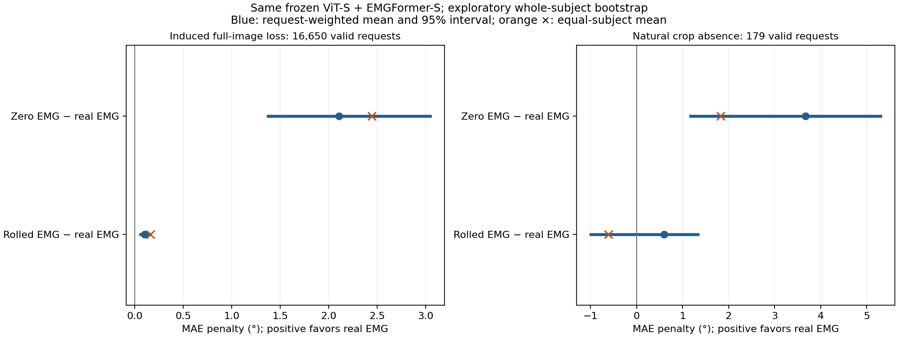

# 视觉缺失时，EMG 是否有用？

2026-11-04：**同一冻结 ViT-S＋EMGFormer-S 融合模型的完整受控实验已完成。完全屏蔽图像时，真实 EMG 相比置零 EMG 平均降低 MAE 2.1065°，41 个用户／录制组中38组改善。** 这支持该模型在缺图时利用了 EMG；时间对齐的额外收益较小，且尚未证明融合稳定优于独立纯视觉模型。RN18 的完整原始遮挡基线也已验收；该路线的同模型六条件对照继续。

## 完整同模型对照

[退出后独立原始包验收](vits-six-condition-complete-20261104.json)核对两遍各17,168请求、272批、六条件共103,008个条件预测；八类数组及输入指纹精确重放，所有真实对齐预测／目标／原掩码／误差与既有完整基线相同。112个来源拥有者／数据进程和独立读取者均已退出，模型完整state前后一致、0优化更新／无CUDA。

下面只统计16,650个原标签有效请求，MAE越低越好；原始17,168个请求（含518无效标签及695缺crop）全部保留。每行22角原始弧度误差乘官方57.3后求均值，未先舍入。

| 图像条件 | 真实对齐 EMG | 全部归一化EMG置零 | 同窗口半长度循环时移 | 置零相对真实误差增加 | 时移相对真实误差增加 |
| --- | ---: | ---: | ---: | ---: | ---: |
| 原图及原缺图标志 | 6.3535° | 6.4000° | 6.3602° | 0.0465° | 0.0067° |
| 人为完全屏蔽图像 | 17.2131° | 19.3197° | 17.3124° | **2.1065°** | **0.0992°** |
| 自然缺crop的179个有效请求 | 18.1111° | 21.7848° | 18.7044° | **3.6737°** | 0.5933° |

归一化置零严格对应原生 `force_zero_emg` 的整个输入张量（含布局填充通道），不是原始电压零或静息肌电。时间时移固定为同一请求沿时间轴循环3895点，不交换用户、split或窗口；它保留EMG信息并产生人工接缝，不能充当“完全无姿态信息”的对照。缺图使用原RGB字节黑图归一化及false视觉标志，**标签掩码保持不变**；自然缺crop与人为屏蔽分列。

## 用户／录制间是否稳定

[固定元数据连接](legacy-subject-groups-20261103.json)提供41个 `episode_subject` 标记与匿名组号，每标记一段录制；物理身份独立性和PDF人口等价尚未证明。保留组内全部窗口，对组重采样10,000次（seed20261103）的探索性95%百分位区间如下；没有作多重比较校正，不宣称预注册显著性。

| 对照：误差增加表示真实EMG更好 | 请求等权改善 | 每用户等权改善 | 改善组数 | 探索性整组区间 |
| --- | ---: | ---: | ---: | ---: |
| 人为缺图：置零−真实 | 2.1065° | 2.4407° | 38/41 | [1.3746°, 3.0433°] |
| 人为缺图：时移−真实 | 0.0992° | 0.1614° | 32/41 | [0.0590°, 0.1553°] |
| 自然缺图：置零−真实 | 3.6737° | 1.8230° | 9/13 | [1.1741°, 5.2990°] |
| 自然缺图：时移−真实 | 0.5933° | −0.6164° | 6/13 | [−0.9927°, 1.3266°] |

置零实验支持模型使用了EMG，尤其是在人为缺图时。但置零可能偏离训练分布，不能直接等同于重新训练一个无EMG模型。自然缺图的时间对齐收益在用户等权后方向改变、区间跨0；这部分仍不足以证明稳定的精确时间对齐优势。

## 与独立模型比较

同样的人为缺图下，独立纯视觉模型为17.4548°、融合真实EMG为17.2131°，平均改善0.2417°，探索性整组区间 **[−0.1332°, 0.5995°]**，跨0。两个原生网络对视觉标志的处理不同，因此这一比较也不能单独隔离EMG贡献。

自然缺图179个有效请求中，纯视觉／纯EMG／融合分别为18.5226°／17.6646°／18.1111°。融合84请求改善、95变差；13组5改善／8变差，每用户等权收益−0.0985°，探索性整组区间[−1.4745°, 2.5192°]。**“模型利用了EMG”和“融合能稳定优于纯视觉”是两项不同结论，目前后者仍不成立。** [既有模型比较](vits-existing-subject-analysis-20261103.json)保留其原口径。

## 证据与复算

- [六条件完整描述统计](vits-controls-full/metrics.json)、[分组条件CSV](vits-controls-full/condition-results.csv)、[逐请求未舍入误差与标志](vits-controls-full/raw-control-errors.csv)。
- [用户分组分析与方法](vits-controls-subject-analysis-20261104.json)、[逐用户配对CSV](vits-controls-per-subject-20261104.csv)。所有17,168键／原对齐误差／标签与crop标志重新连接，独立标准库 `math.fsum` 均值与完整报告一致。
- 从仓库根目录执行 `python scripts/paper/analyze_vits_controls.py --verify` 可重新核对全部连接、均值、用户组重采样和数值文件字节；使用 `--output 新目录` 可重新生成分析与图片。
- [固定实验语义](../../docs/superpowers/specs/2026-11-03-visual-missing-emg-controls-addendum.md)、[完整执行计划](../../docs/superpowers/plans/2026-11-03-visual-missing-emg-controls.md)、[一次审查及修正验收](control-workflow-review-acceptance-20261103.json)。
- [RN18原完整密网格及退出后验收](../native-dense-occlusion/rn18-complete-prediction-report-20261104.json)：两遍各11,114请求、176批，53来源／61.377GB完整重哈希；其受控结果不能用ViT-S结果替代。

使用可得旧版数据；PDF人口／标签／物理相机等价尚未建立。原始密网格存在已披露的训练输入窗口交叠；本页是固定旧版管线的敏感性分析，不代表完全隔离的新测试集。自然遮挡、实际缺crop和人为缺图分别报告，0.6/0.8遮挡分组为探索性。RN18六条件、其Figure7补充、EMG2Pose完整250轮及标注流程等全文缺口仍继续。
